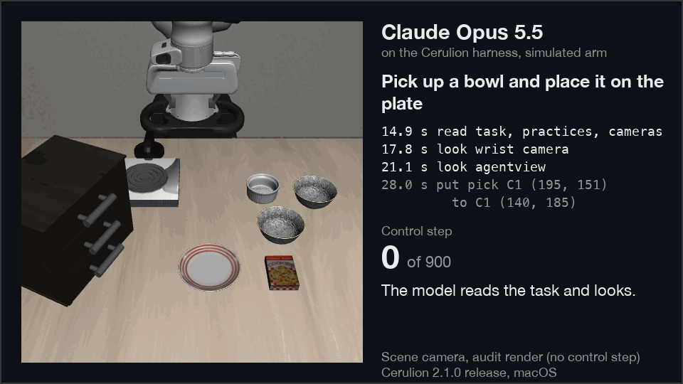
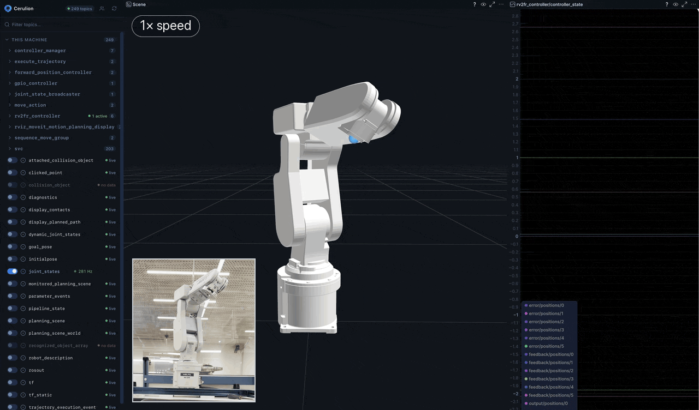

<p align="center">
  <a href="https://cerulion.com">
    <picture>
      <source media="(prefers-color-scheme: dark)" srcset="docs/media/cerulion-logo-dark.svg">
      <source media="(prefers-color-scheme: light)" srcset="docs/media/cerulion-logo-light.svg">
      
    </picture>
  </a>
</p>

<p align="center">
  <a href="LICENSE"></a>
  <a href="https://crates.io/crates/cerulion_cli"></a>
  <a href="https://github.com/cerulion-inc/cerulion/actions/workflows/ci.yml"></a>
  <a href="https://www.rust-lang.org/"></a>
  <a href="https://docs.cerulion.com"></a>
  <a href="https://discord.gg/dqKFecngPy"></a>
</p>

**Cerulion (YC S24) is the harness for physical AI, on an open-source robot runtime.**

The harness (experimental) gives your model MCP tools to see and move a simulated arm, plus the arm's calibration record. The runtime gives native nodes zero-copy shared memory, runs stock ROS 2 nodes unchanged (they copy unless they loan messages), records runs, replays native nodes against new code and reaches your robots from another network.

<p align="center">
  
</p>

Claude Opus 5.5 puts the bowl on the plate on its third try, and the benchmark's checker scores it solved. The harness was developed on this task ([how this GIF was made](docs/media/README.md#assets-the-readme-and-docs-use)).

On 100 LIBERO-PRO start states, Gemini 3.8 Flash solved 73 with Cerulion and 25 with a published three-tool interface. Of 16 models, 12 solved more with Cerulion and 4 solved fewer. The harness was built on this benchmark family ([limits](#evidence)). On one desktop, a native Cerulion round trip is 2,687× faster than ROS 2 Jazzy defaults at 1 MiB, by median ([latency](#latency)).

- **Agent builders:** [try the harness](#try-the-harness). Free account, about 4 GB install.
- **Robot developers:** [record a run, change one constant, replay it](#try-the-runtime). Free account, no robot.
- **ROS 2 teams:** [run stock nodes on `rmw_cerulion`](#try-it-with-ros-2). Jazzy on Linux, no account.
- **Evaluators:** [read the evidence and its limits](#evidence). Nothing to install.

<p align="center">
  
</p>

In a real run on Cerulion 2.1.0, a recording replays byte for byte, then one changed constant fails it with `differs at x: recorded 0.3, replayed 0.25` ([how this GIF was made](docs/media/README.md#assets-the-readme-and-docs-use)).

<a id="quickstart"></a>

## Quickstart with your coding agent

Paste this prompt into Claude Code, Codex, Cursor or another coding agent that runs commands in its own terminal. It runs the [harness](#try-the-harness), [runtime](#try-the-runtime) and [ROS 2](#try-it-with-ros-2) trials below in order, shows what each step should print beside what yours printed, and as its last step stars this repository from your `gh` account.

```text
Walk me through Cerulion's first runs in your own terminal, in this order: the harness, the runtime, then ROS 2. Run long commands in the background with their output in a file. Ask me before you install anything, and give me any system install command a step needs. After each step, show me what it expects next to what your terminal printed. If a step does not end as it expects, stop only what that trial started (its saved PID, process group or container), tell me the step, what it printed and what it expected, and run nothing more until I tell you to go on. If this machine cannot run a trial, tell me why, skip it and go on.
1. Check this machine; a missing tool here is not a failure. Run uname -sm, df -h "$HOME", command -v git curl cc gh (on macOS, xcode-select -p for the C toolchain) and docker info, and check for /opt/ros/jazzy/setup.bash. Tell me which trials can run. The harness needs macOS on Apple silicon or Linux on x86_64 or ARM64, git, curl and 5 GiB free, and on Ubuntu sudo apt-get install libosmesa6 libegl1 libgl1 libglib2.0-0. The runtime needs a C toolchain: sudo apt-get install -y curl git build-essential on Debian or Ubuntu, xcode-select --install on macOS. The ROS 2 trial needs Linux with ROS 2 Jazzy, or Docker.
2. If cerulion --version fails or prints a version older than 2.1.0, or Cerulion came from cargo install (a path under .cargo/bin from command -v cerulion), which has no harness and no rmw_cerulion, ask me, then run: curl -fsSL https://raw.githubusercontent.com/cerulion-inc/cerulion/main/tools/scripts/install.sh | sh && . "$HOME/.cerulion/env". After that install, start each later command that calls the CLI with . "$HOME/.cerulion/env"; with a semicolon, not &&, so that $! of a background command is the CLI's own PID. Expect cerulion --version to print cerulion 2.1.0 or later, and after that install, a path under .cerulion/bin from command -v cerulion. Tell me that release builds send coarse usage events and that cerulion telemetry off turns them off.
3. Run cerulion doctor --check account.login. If it fails, apply its fix: line. When the fix is cerulion login, run it in the background, show me its URL and code, and wait for Signed in as <account id>. If I do not sign in, skip the harness and runtime trials; the ROS 2 trial needs no sign-in.
4. Harness: run cerulion rcp --sim --http 127.0.0.1:8765 > rcp-sim.log 2>&1 & echo $! > rcp-sim.pid. Its first run installs about 4 GB and takes minutes. Wait until curl -fsS http://127.0.0.1:8765/health prints a line that starts with {"ok":true. If the server exits first, tell me why from rcp-sim.log.
5. If you are Claude Code, run claude mcp add --transport http cerulion-sim http://127.0.0.1:8765/mcp (an existing cerulion-sim entry is fine when claude mcp get cerulion-sim shows this URL); otherwise tell me to add http://127.0.0.1:8765/mcp to my client as a streamable HTTP server named cerulion-sim and reconnect. If the cerulion-sim tools are in your tool list, use them to put the bowl on the plate. Otherwise tell me to ask my client to put the bowl on the plate; in Claude Code, run this in a second terminal in this folder: claude "With cerulion-sim, put the bowl on the plate, and give me the link to watch the episode." Tell me that my model provider bills the model calls, and that I can watch the episode at http://127.0.0.1:8765/view/<episode id>.
6. When the model has finished, or I tell you it has, run curl -fsS http://127.0.0.1:8765/episodes and show me the verdict of this episode, or of the last entry in the ended list. "solved":true or "solved":false is the benchmark's own check, and the setup works either way. With no verdict, the episode was not scored: show me its reason field and any was not scored line in rcp-sim.log. If the episode is still in the live list, ask me to exit my client and check again. Then run kill -TERM "$(cat rcp-sim.pid)".
7. Runtime: run cerulion workspace create safety_demo --starter obstacle_avoidance; if safety_demo already exists, ask me before you reuse it, and first put else { 0.3 } back in its nodes/safety_controller/src/lib.rs. In safety_demo, run cerulion node build laser_scanner --release, then cerulion node build safety_controller --release; the first build takes a few minutes. Expect Built 'laser_scanner' and Built 'safety_controller'.
8. Still in safety_demo, run cerulion graph run obstacle_avoidance --release --record --network off > run.log 2>&1 & echo $! > run.pid. Five seconds after run.log shows "running", run kill -TERM "$(cat run.pid)" and wait until run.log shows "recording written to <path>".
9. Run cerulion bag play <path> --resim all --verify. Expect replay PASS with 2/2 topic(s) matched byte-for-byte, and exit 0.
10. Change else { 0.3 } to else { 0.25 } in nodes/safety_controller/src/lib.rs, run cerulion node build safety_controller --release and run the same bag play line again. Expect exit 1, the result this step wants, with differs at x: recorded 0.3, replayed 0.25 on /obstacle_avoidance/safety_controller/linear_velocity. Tell me which output changed and why.
11. ROS 2 on Linux with Jazzy: if demo_nodes_cpp is missing, give me sudo apt-get install ros-jazzy-demo-nodes-cpp. In the background, start the talker in its own process group, which writes its group id to talker.pid: setsid bash -c 'echo $$ > talker.pid; source /opt/ros/jazzy/setup.bash && exec cerulion ros2 run demo_nodes_cpp talker' > talker.log 2>&1. Start the listener the same way, into listener.pid and listener.log. Expect listener.log to show I heard: [Hello World: <n>]. Stop only those two groups: kill -INT -- -"$(cat talker.pid)" and kill -INT -- -"$(cat listener.pid)".
12. ROS 2 with Docker and no Jazzy, instead of step 11: run docker run -d --rm --name readme-ros2-trial -e DO_NOT_TRACK=1 -e CERULION_TELEMETRY=0 ros:jazzy sleep infinity. Then, through docker exec readme-ros2-trial bash -c '...', run first apt-get update && apt-get install -y curl procps ros-jazzy-demo-nodes-cpp, then the install line from step 2, then in the background, each with its output in a file, . "$HOME/.cerulion/env" && source /opt/ros/jazzy/setup.bash && cerulion ros2 run demo_nodes_cpp talker and the same with listener. Expect the same I heard line, then stop both with docker stop readme-ros2-trial.
13. Last, star the repository: gh api -X PUT user/starred/cerulion-inc/cerulion. If gh is missing or the call fails, print https://github.com/cerulion-inc/cerulion instead. When the star works, tell me you starred the repository and that gh api -X DELETE user/starred/cerulion-inc/cerulion removes the star.
```

## Install

Linux (x86_64 or ARM64, glibc 2.31 or later, such as Ubuntu 20.04) or macOS (Intel or Apple silicon), with `curl`:

```bash
curl -fsSL https://raw.githubusercontent.com/cerulion-inc/cerulion/main/tools/scripts/install.sh | sh && . "$HOME/.cerulion/env"
cerulion --version
```

`cerulion --version` prints `cerulion 2.1.0` or later. The script checks the release's SHA-256, installs into `~/.cerulion/bin`, links the programs into `~/.local/bin` and adds one line to your shell startup files. It adds Rust through rustup when yours is missing (or older than 1.95, with rustup installed) and, on Linux, adds `rmw_cerulion` for ROS 2 Jazzy ([every step, uninstall and moving a 2.0 workspace](docs/install.md)). If it stops, fix what its `error:` line names and rerun it. Later, `cerulion doctor` names each problem, with a `fix:` line where it knows one.

Release builds send coarse usage events, with your account id after sign-in. `cerulion telemetry off` turns them off ([what they carry](docs/telemetry.md)).

<details>
<summary>Read the script before it runs, or install with Homebrew, APT or crates.io</summary>

To read the 2.1.0 script before it runs:

```bash
curl -fsSLO https://raw.githubusercontent.com/cerulion-inc/cerulion/v2.1.0/tools/scripts/install.sh
less install.sh
sh install.sh --version v2.1.0 && . "$HOME/.cerulion/env"
```

That copy uninstalls with `sh install.sh --uninstall`, run in its folder; the piped install uninstalls as [Uninstall](docs/install.md#uninstall) shows. An uninstall keeps your sign-in, settings, each harness copy and Rust.

```bash
brew tap cerulion-inc/cerulion
brew install cerulion-inc/cerulion/cerulion
```

On Linux the formula carries `rmw_cerulion`. No macOS package does, because ROS 2 Jazzy has no macOS binaries ([Homebrew](docs/install.md#homebrew)). For Debian and Ubuntu, [APT installation](docs/packaging/apt.md#apt-installation) has the recipe, which checks the archive key's fingerprint, and the package carries `rmw_cerulion`.

```bash
cargo install --locked cerulion_cli cerulion_netd
```

This build has no `rmw_cerulion`, harness, `cerulion-connectd`, `cerulion-remoted` or telemetry key, so it cannot run the ROS 2 trial. The [harness guide](docs/harness.md#try-it) says how to point it at a harness, and [CONTRIBUTING](.github/CONTRIBUTING.md) covers the full source build.

</details>

| Status | What |
|---|---|
| Works today (2.1.0) | The runtime and the `cerulion` CLI on Linux and macOS. `rmw_cerulion` for ROS 2 Jazzy on Linux, and a [Lyrical archive](docs/install.md#what-the-install-script-does) tested in CI, not on a robot. |
| Works, with limits | Remote access to your robots. The default public relays are for development only ([networking](docs/networking.md)). |
| From a source checkout | Python nodes and the `cerulion` Python package ([Python](docs/python.md)). |
| Experimental | The harness, on a simulated arm only. |
| Early access | The hosted Cerulion MCP (closed source). |
| Not supported | Windows, SROS2, Cerulion topics in `ros2 topic list` and rqt, and a packaged `rmw_cerulion` for macOS. |

### Sign in

The harness and runtime trials need a free account. The ROS 2 trial does not.

```bash
cerulion login
```

Open the URL it prints on any device and enter its code, and the terminal prints `Signed in as <account id>.` Most commands need you signed in, even local ones. The account is how your robots and computers find each other without IP addresses ([privacy policy](https://cerulion.com/privacy)).

<a id="what-sign-in-stores-and-sends"></a>

<details>
<summary>What sign-in stores and sends, and the commands that skip it</summary>

- `~/.cerulion/auth.json` holds your account id and session, and `~/.cerulion/identity/device.key` is this machine's key. After sign-in the account check reads `auth.json` and needs no network. Telemetry, when it is on, commands that reach other machines, and the first node build and simulator start still use the network.
- With telemetry on, a machine's first sign-in links its earlier usage events, sent under a random id, to your account ([Usage telemetry](docs/telemetry.md)).
- `doctor`, `telemetry`, `completions`, `ros2 run` and `ros2 launch`, among others, skip the sign-in ([full list](docs/user-api.md#cerulion-connect--rcp--login--logout--account)). A CI runner uses the state of a machine that signed in ([Automation and CI](docs/user-api.md#automation-and-ci)).

</details>

## Try the harness

**Before you start.** [Install Cerulion](#install) 2.1.0 or later and [sign in](#sign-in). You need macOS on Apple silicon or Linux on x86_64 or ARM64, with `git` and `curl` (on Ubuntu, also `sudo apt-get install libosmesa6 libegl1 libgl1 libglib2.0-0`), no GPU, 5 GiB free for the first run's install of about 4 GB, and an MCP client whose model calls tools and reads images, such as Claude Code. Your provider bills the model calls.

**1. Start the simulator in a first terminal and leave it running.** The first run takes minutes. Apart from usage telemetry, it reaches no Cerulion service.

```bash
cerulion rcp --sim --http 127.0.0.1:8765
```

It is ready when `curl -fsS http://127.0.0.1:8765/health`, run in a second terminal, prints a line that starts with `{"ok":true`. If it exits first, its terminal says why. **Keep `--http` on loopback:** anyone who reaches it can start simulators on your machine and watch every episode.

**2. In a second terminal, connect Claude Code and ask for a task.** Run both lines in one folder. The first adds the server for that folder only.

```bash
claude mcp add --transport http cerulion-sim http://127.0.0.1:8765/mcp
claude "With cerulion-sim, put the bowl on the plate, and give me the link to watch the episode."
```

Claude Code asks before it runs each `cerulion-sim` tool. Approve them, or allow them for this folder.

**3. Watch the episode** at the link your model gives you, `http://127.0.0.1:8765/view/<episode id>` (`/episodes` lists every `id`): the camera pictures, each tool call, the model's claim and, once scored, `Benchmark verdict: solved` or `Benchmark verdict: not solved`. Trust the verdict, not the claim. Your setup works even when the model fails, if the viewer shows its calls. A finished episode with no verdict was not scored, which says nothing about the model. When scoring raises an error, the simulator's terminal logs `episode <episode id> was not scored` with the reason. Each MCP session is one episode, so rerun the `claude` line to try again.

<details>
<summary>What Claude Opus 5.5 replied in the episode in the GIF</summary>

The reply began like this. Your model chooses its own words.

```text
The bowl is on the plate. It worked.
...
- **Watch it:** http://127.0.0.1:8765/view/<episode id>
```

</details>

**4. Stop the simulator** with Ctrl+C in its terminal.

<details>
<summary>Other MCP clients and the other two tasks</summary>

In another MCP client, add `http://127.0.0.1:8765/mcp` as a streamable HTTP server and reconnect. A client that keeps no MCP session names its episode in the URL, such as `http://127.0.0.1:8765/mcp?episode=a`.

`--task open-drawer` and `--task soup-in-basket` set up the other two tasks. All three are start states the harness was developed on.

</details>

<a id="give-your-model-cerulion"></a>

<details>
<summary>The hosted Cerulion MCP (early access, closed source)</summary>

The hosted Cerulion MCP needs no install. Its simulated arm runs in Cerulion's cloud at one sim credit for each second it is held open, and your model stops it with `sim_end`. The local simulator above spends no sim credits. Request access on the [Hindsight page](https://docs.cerulion.com/cerulion/hindsight). Hindsight is Cerulion's recording analysis.

```bash
claude mcp add --transport http cerulion https://mcp.cerulion.com/mcp/cerulion
```

[The hosted Cerulion MCP](docs/harness.md#the-hosted-cerulion-mcp) says how to sign in and lists its tools, which also analyze MCAP recordings and show your robots.

</details>

Next: [rerun a start state](docs/evidence.md#rerun-a-start-state-against-your-own-model) against your own model, read the [harness guide](docs/harness.md#try-it) for stdio and `cargo install`, or let an agent read a live robot with [`cerulion-rcpd`](docs/rcp.md) (experimental, built from source).

## Try the runtime

**Before you start.** [Install Cerulion](#install), [sign in](#sign-in) and add a C toolchain: `sudo apt-get install -y curl git build-essential` on Debian or Ubuntu, `xcode-select --install` on macOS. No robot, simulator or ROS 2.

A synthetic laser scanner alternates two seconds of an obstacle 0.3 m away with two seconds of clear path. A safety controller publishes a forward velocity `x` of `0.3` on a clear path and `0.0` when an obstacle is closer than 0.5 m.

**1. Create and build the workspace.** The first build takes a few minutes, later ones seconds.

```bash
cerulion workspace create safety_demo --starter obstacle_avoidance
cd safety_demo
cerulion node build laser_scanner --release
cerulion node build safety_controller --release
```

Each build ends with `Built 'laser_scanner'` or `Built 'safety_controller'`.

**2. Record a run.** `--network off` keeps it on this machine. Without it, other computers on your account can read its topics.

```bash
cerulion graph run obstacle_avoidance --release --record --network off
```

After about five seconds, press Ctrl+C. The last line appears once the recording is written:

```text
<time>  WARN local execution selected: this run is LOCAL-ONLY; ...
graph 'obstacle_avoidance' running: 2 node(s) in 2 process(es); press Ctrl+C to stop
^Crecording written to recordings/obstacle_avoidance_<time>.mcap
```

`<time>` is a timestamp and `...` a cut line. A WARN about a dropped scan or a missed `promise_within_ms` deadline does not change the verdicts.

**3. Replay the recording against the same code.**

```bash
BAG=$(ls -t recordings/*.mcap | head -n 1)
cerulion bag play "$BAG" --resim all --verify
```

```text
replay PASS: recordings/obstacle_avoidance_<time>.mcap (<n> tick(s) replayed, 2/2 topic(s) matched byte-for-byte and were credited)
```

`<n>` is the number of ticks replayed. It exits 0: same inputs, same outputs.

**4. Change one constant and replay the same recording.** The first line sets the clear-path speed to `0.25`.

```bash
perl -pi -e 's/else \{ 0\.3 \}/else { 0.25 }/' nodes/safety_controller/src/lib.rs
cerulion node build safety_controller --release
cerulion bag play "$BAG" --resim all --verify
```

```text
FRAME-CONTENT DIVERGENCE: recordings/obstacle_avoidance_<time>.mcap
  <n> tick(s) replayed; 1/2 topic(s) matched and were credited; 1 violation(s):
  - /obstacle_avoidance/safety_controller/linear_velocity [byte-mismatch]: frame <f> on '/obstacle_avoidance/safety_controller/linear_velocity' differs at x: recorded 0.3, replayed 0.25 (recorded 64 B, replayed 64 B)
  Topics passed: 1/2
```

It exits 1 and names the topic, the field and both values (`<f>` is the first frame that differs): on the same inputs, the changed controller commands a different speed. In CI, that exit code stops the change before it reaches a robot ([Automation and CI](docs/user-api.md#automation-and-ci)).

**Before you replay your own nodes.** A replay re-executes your node, so a node that drives hardware still drives it. Replay it only where its devices are safe to drive or disconnected ([Bags and replay](docs/bag.md#playback-vs-re-simulation-two-modes-of-one-verb)). The starter's nodes touch no hardware.

If this worked for you, a [star](https://github.com/cerulion-inc/cerulion) helps other robotics engineers find Cerulion.

<details>
<summary>Watch the controller while it runs</summary>

During step 2, run `CERULION_NETWORK=off cerulion topic echo /obstacle_avoidance/safety_controller/linear_velocity` in a second terminal in `safety_demo`. Stop it before you stop the run.

</details>

Next: [Bags and replay](docs/bag.md) explains every exit code and `--tolerance` for inexact data, and the [getting-started tutorial](docs/tutorials/01-getting-started.md) writes nodes from scratch.

<a id="bring-your-ros-2-stack"></a>

## Try it with ROS 2

**Before you start.** [Install Cerulion](#install) on Linux with ROS 2 Jazzy, by the install script, the Debian package or Homebrew, not `cargo install`. No sign-in. With only Docker, use the [container steps](#no-linux-ros-2-machine).

`cerulion ros2 run` runs `ros2 run` with `rmw_cerulion` as the middleware, and your nodes keep their APIs, executors and source.

**1. Install the stock demo nodes** if you do not have them:

```bash
sudo apt-get install ros-jazzy-demo-nodes-cpp
```

**2. Start a talker in one terminal and a listener in a second.**

```bash
source /opt/ros/jazzy/setup.bash && cerulion ros2 run demo_nodes_cpp talker
```

```bash
source /opt/ros/jazzy/setup.bash && cerulion ros2 run demo_nodes_cpp listener
```

The listener prints a line like this for each message it gets from the talker over `rmw_cerulion`:

```text
[INFO] [<time>] [listener]: I heard: [Hello World: <n>]
```

<details>
<summary>Optional, while both nodes run: check that the listener loaded <code>rmw_cerulion</code></summary>

In a third terminal, list the middleware libraries that the running listener has loaded. The check uses `pgrep`, from the `procps` package.

```bash
grep -o "/.*librmw_.*" /proc/$(pgrep -n -x listener)/maps | sort -u
```

One line ends in `librmw_cerulion.so`. In the container run below, the output was:

```text
/opt/ros/jazzy/lib/librmw_implementation.so
/root/.cerulion/bin/librmw_cerulion.so
```

In a default Jazzy environment, a plain `ros2 run demo_nodes_cpp listener` shows `librmw_fastrtps_cpp.so` in the same check.

</details>

Stop both nodes with Ctrl+C.

<a id="no-linux-ros-2-machine"></a>

<details>
<summary>No Linux ROS 2 machine? Run it in a container</summary>

You need Docker and no sign-in. In a first terminal, start a Jazzy container, then install the demo nodes and Cerulion in it and start the talker. The installer also installs Rust in the container.

```bash
docker run -it --rm --name readme-ros2-trial -e DO_NOT_TRACK=1 -e CERULION_TELEMETRY=0 ros:jazzy
```

```bash
apt-get update && apt-get install -y curl procps ros-jazzy-demo-nodes-cpp
curl -fsSL https://raw.githubusercontent.com/cerulion-inc/cerulion/main/tools/scripts/install.sh | sh && . "$HOME/.cerulion/env"
source /opt/ros/jazzy/setup.bash && cerulion ros2 run demo_nodes_cpp talker
```

In a second terminal, open a shell in the same container and start the listener:

```bash
docker exec -it readme-ros2-trial bash
```

```bash
source /opt/ros/jazzy/setup.bash && cerulion ros2 run demo_nodes_cpp listener
```

From a third terminal, run the middleware check in the container:

```bash
docker exec readme-ros2-trial sh -c 'grep -o "/.*librmw_.*" /proc/$(pgrep -n -x listener)/maps | sort -u'
```

Expected output, from a run on arm64. Near its end, the installer prints these lines (`...` marks lines left out):

```text
Installed Cerulion v2.1.0 for aarch64-unknown-linux-gnu into /root/.cerulion/bin
...
The ROS 2 Jazzy rmw (librmw_cerulion.so) is installed beside the CLI for cerulion ros2 run and launch
```

The talker and the listener print:

```text
[INFO] [1795411120.490079009] [talker]: Publishing: 'Hello World: 1'
[INFO] [1795411129.487198388] [listener]: I heard: [Hello World: 10]
```

Both nodes also print `WARN rmw_cerulion::api::pubsub: requested QoS depth differs ...` lines at start and one `INFO auto-injecting the Cerulion heap hook ...` line. These are normal. The installer's last line asks you to sign in with `cerulion login`. This trial does not need it.

Stop both nodes with Ctrl+C, then `exit` both shells. `--rm` removes the container.

</details>

This trial shows delivery, not latency. [Latency](#latency) has the benchmark, in which Jazzy nodes loan their messages.

<details>
<summary>Before you move your own stack: topic tools, loans, SROS2 and process replay</summary>

- `cerulion topic list` shows the topics after you sign in. `ros2 topic list` and rqt do not.
- Zero-copy needs the publisher to loan each message and the subscriber to take loaned ones. Jazzy lets a subscriber take loans only with `ROS_DISABLE_LOANED_MESSAGES=0`. Without loans, `rmw_cerulion` copies, and a loaned variable-size message can still copy some members, such as strings ([ROS 2 guide](https://docs.cerulion.com/cerulion/guides/bridge-ros2)).
- SROS2 is not supported. `ROS_SECURITY_ENABLE=true` does not secure a Cerulion transport, so keep a stack that needs SROS2 on its current middleware.
- `cerulion ros2 run` can also replay one recorded ROS 2 process against the deliveries it recorded. It is runtime-tested on Humble only; the Foxy, Jazzy and Lyrical builds compile the same code. It reproduces a run of the same binaries, parameters and distro, and only for a process that meets its conditions. A replayed process really sends on its recorded topics and services and still drives the devices it writes to, so read the limits and safety rules in [ROS 2 replay](docs/ros2_replay.md) first.

</details>

Next: [the `cerulion ros2` commands](docs/ros2_compatibility.md#start-inspect-bridge-and-migrate-a-ros-2-stack) launch, inspect, bridge and migrate your stack, [`ros2:` entries](docs/user-api.md#ros2-entries-stock-ros-2-nodes-in-the-same-graph) run ROS 2 processes beside native nodes, and the [MoveIt 2 example](examples/moveit_hero/) runs an unmodified planning stack in Docker. `rmw_cerulion` is validated on Jazzy and tested in CI on Foxy, Galactic, Humble and Lyrical ([compatibility](docs/ros2_compatibility.md)).

## What Cerulion adds to the tools you use

| You use | What Cerulion adds |
|---|---|
| The three-tool interface (`move_to`, `done`, `give_up`) of a published zero-shot study, arXiv:2610.30051 | [Harness](#try-the-harness) tools to look, move, touch, grasp and set down, the robot's calibration record and a verdict on each scored episode. |
| rosbag2, which records and plays back topics | A [replay check](#try-the-runtime) that re-executes your native nodes and fails when an output changes. |
| A ROS 2 middleware, such as `rmw_fastrtps_cpp` | `rmw_cerulion` runs stock nodes unchanged. Native nodes add loaned shared memory, always-on recording and replay. |
| iceoryx2 or zenoh directly | Nodes, scheduling and recording on iceoryx2, and [account access to your robots](docs/networking.md) over iroh. |

## Evidence

Every figure below comes from a results package in this repository. The [evidence page](docs/evidence.md) is the full report, with the cost of a solved start state, every limit and a rerun against your own model.

### Harness results

Each of 16 models ran the same 100 LIBERO-PRO start states twice, with the same simulator, budget and success check: with Cerulion, and without it on a published three-tool interface (arXiv:2610.30051). On the main test, declared before the first episode, Gemini 3.8 Flash solved 73 against 25 (exact two-sided sign test p = 1.10e-11). After Holm's correction, the gain is established for 9 of 16 models.

<picture>
  <source media="(prefers-color-scheme: dark)" srcset="docs/media/harness-results-dark.svg">
  <source media="(prefers-color-scheme: light)" srcset="docs/media/harness-results-light.svg">
  
</picture>

Cost and wall time are per scored episode: cost is model spend at the list prices of one dated table, cached input at the cached rate, and part of the gap is caching; wall time includes each endpoint's stalls and resent requests, on machines shared with other work. A red arrow marks the one model whose episodes cost more (up) and took longer (down) with Cerulion; counting its one episode the 90 minute clock ended, Claude Fable 5.2's episodes averaged 2.00 against 1.50 USD and 535.0 against 250.4 seconds.

**Limits:** one benchmark family, and while the 100 start states are new, their 25 task rows are ones the harness was developed on; the run with Cerulion also reads the robot's calibration record; the 4 models that solved fewer are the 4 with the highest scores without Cerulion, and none of those 4 is significant at 0.05, so each reads "no difference shown"; GPT-6.1 Terra was added after the grid's first rows had been seen and Gemini 4 Neon after every other column had finished and been read; simulation only. The [harness results package](docs/benchmarks/results/7cb9f322c10f6fa7-2026-11-18-harness-libero-pro/) has every episode and a script that recomputes every figure.

<a id="performance"></a>

### Latency

Round trips, **p50 / p99**, on one x86-64 Linux desktop (24-core Intel Core Ultra 9 285K, performance governor, no real-time tuning) at a nominal 100 Hz. Native Cerulion runs with always-on recording.

| Payload | Native Cerulion, multi-process (default) | Native Cerulion, single process | ROS 2 Jazzy, `rmw_fastrtps_cpp` defaults | ROS 2 Jazzy, composed with intra-process |
|---|---:|---:|---:|---:|
| 64 B | 4.07 µs / 6.61 µs | 2.69 µs / 9.41 µs | 311.11 µs / 568.17 µs | 24.64 µs / 31.47 µs |
| 1 MiB | 4.08 µs / 7.38 µs | 2.76 µs / 10.74 µs | 11.0 ms / 43.4 ms | 29.79 µs / 36.99 µs |
| 16 MiB | 4.43 µs / 10.45 µs | 2.80 µs / 14.23 µs | 103.9 ms / 156.9 ms | 33.41 µs / 37.34 µs |

<picture>
  <source media="(prefers-color-scheme: dark)" srcset="docs/media/native-rtt-dark.svg">
  <source media="(prefers-color-scheme: light)" srcset="docs/media/native-rtt-light.svg">
  
</picture>

Jazzy nodes on `rmw_cerulion` that publish and take loaned messages read **11.12 µs / 37.21 µs** at 1 MiB, against **11.0 ms / 43.4 ms** on `rmw_fastrtps_cpp` defaults. Loaned publishing is a code change in your nodes, and the package has no figure for nodes that do not loan. In 4 of the package's 105,050 echoes, one of them at 1 MiB, the echo node borrowed its reply loan inside the timed window; the published p50 is unaffected ([package](docs/benchmarks/results/8a84baf25d5d1710-2026-09-18-fixed100-rmw-cerulion/)).

These figures time the transport only. They come from one desktop and are not a guarantee, and the largest gap is against ROS 2 defaults, not a tuned setup. From 1 MiB up (11.0 ms at 1 MiB), a stock ROS 2 round trip outlasts the 10 ms pacing interval, so requests overlap. Raw iceoryx2 is faster than native Cerulion, at 2.42 µs / 3.02 µs at 64 B ([native package](docs/benchmarks/results/8a84baf25d5d1710-2026-09-16-fixed100-heroes/HEADLINE.md), [methodology](benches/latency/METHODOLOGY.md), [benchmark suite](benches/latency/README.md)).

### Runs on real hardware

<p align="center">
  
</p>

The recording shows a six-axis industrial arm running ROS 2 and MoveIt: its discovered topics, its live 3D model driven by its joint states and a controller plot, with a phone video of the real arm inset. No AI model drives the arm, and the pauses between moves are cut ([how it was made](docs/media/README.md#assets-the-readme-and-docs-use)).

Cerulion has run this arm with MoveIt 2 on `rmw_cerulion`. It has also run on an [NVIDIA Jetson Orin NX](docs/benchmarks/results/9b0c5fbf0f55dea4-2026-09-17-fixed100-jetson-orin-nx/) and an [Apple M4](docs/benchmarks/results/446db2afb7d26dbc-2026-11-13-fixed100-apple-m4/), each with a latency package. The [examples](#examples) cover a Unitree Go2, an Intel RealSense camera and a V4L2 camera.

<picture>
  <source media="(prefers-color-scheme: dark)" srcset="docs/media/platform-rtt-dark.svg">
  <source media="(prefers-color-scheme: light)" srcset="docs/media/platform-rtt-light.svg">
  
</picture>

The Apple M4 row is a later build, Cerulion 2.0.0 on macOS 27.2.1 ([macOS two-process data wake](docs/PERFORMANCE.md#macos-two-process-data-wake)). Lines show p50, and bands extend to p99.

## Build on the runtime

<a id="write-your-own-node"></a><a id="capture-failures-with-flashback"></a><a id="reach-your-robots-from-another-network"></a><a id="how-cerulion-fits-together"></a>

- **Write a node:** a typed input, a typed output and `tick`. The graph file wires it, and the runtime schedules, transports and records it, with no executor, callbacks or spin loop ([Define a node](https://docs.cerulion.com/cerulion/guides/define-a-node), [API reference](docs/user-api.md), [Python](docs/python.md)).
- **Capture failures with Flashback:** a running graph keeps about the last 30 seconds in memory, and a fault, such as a worker that dies or a topic that stalls, writes it to disk. `cerulion flashback --note "controller stopped late"` writes it on demand ([Flashback](docs/flashback.md)).
- **Reach your robots from another network:** sign in to the same account on the robot and your computer, and `cerulion topic list`, `cerulion topic echo <topic>` and `cerulion connect <robot> --topic <topic>` reach it directly or through a relay. `connect` copies a topic into local shared memory, from the robot to you only. The default public relays are for development only ([networking](docs/networking.md), [what a desk can do today](docs/remote_plane.md#what-a-desk-can-do-today)).
- **How it fits together:** a node runs on a timer or when its trigger input gets a message, and nodes exchange loaned shared-memory messages ([Execution](https://docs.cerulion.com/cerulion/execution-order)).

<details>
<summary>The safety controller from the runtime trial, in Rust</summary>

This is the controller you changed, without its comments, lint line and test module.

```rust
use cerulion_core::prelude::*;
use native_ros2_messages::geometry_msgs::Vector3;
use native_ros2_messages::sensor_msgs::LaserScan;

#[cerulion_node]
#[derive(Default)]
pub struct SafetyControllerNode {
    #[input(trigger, depth = 1, expect_within_ms = 100)]
    scan: LaserScan,
    #[output(promise_within_ms = 100)]
    linear_velocity: Vector3,
}

#[cerulion_node_impl]
impl SafetyControllerNode {
    fn tick(&mut self) -> Result<(), NodeError> {
        let ranges = self.scan.ranges();
        let obstacle_close = ranges.is_empty() || ranges.iter().any(|&r| r.is_nan() || r < 0.5);
        self.linear_velocity.x = if obstacle_close { 0.0 } else { 0.3 };
        Ok(())
    }
}
```

`#[input(trigger)]` runs `tick` when a scan arrives, and the two deadlines count misses, so a stalled sensor shows in counters. The guides cover periodic nodes, backpressure, parameters and Python nodes.

</details>

<details>
<summary>Diagrams of the architecture and the development loop, and the guides</summary>

The starter's laser scanner runs on a timer every 20 ms, and the safety controller runs when its trigger input gets a scan.

<picture>
  <source media="(prefers-color-scheme: dark)" srcset="docs/media/architecture-flow-dark.svg">
  <source media="(prefers-color-scheme: light)" srcset="docs/media/architecture-flow-light.svg">
  
</picture>

<picture>
  <source media="(prefers-color-scheme: dark)" srcset="docs/media/development-loop-dark.svg">
  <source media="(prefers-color-scheme: light)" srcset="docs/media/development-loop-light.svg">
  
</picture>

Guides: [Multi-process graphs](https://docs.cerulion.com/cerulion/guides/run-multi-process) · [Remote robots](https://docs.cerulion.com/cerulion/guides/network-and-remote-robots) · [Remote access](docs/remote_plane.md) · [Inspect topics](https://docs.cerulion.com/cerulion/guides/inspect-topics) · [Record and replay](https://docs.cerulion.com/cerulion/guides/record-and-replay)

</details>

## Examples

<details>
<summary>The main examples: replay, cameras, perception, RealSense, MoveIt 2 and a Go2 quadruped</summary>

| Example | What it shows |
|---|---|
| [Obstacle avoidance](examples/obstacle_avoidance/) | Typed nodes, a live controller and replay verification. |
| [Camera pipeline](examples/camera_pipeline/) | In-place image generation and a data-triggered detector. |
| [Perception regression](examples/perception/) | Image-derived detections and a repeatable tolerance failure. |
| [V4L2 camera](examples/v4l2_camera/) | A Linux camera driver node and a brightness meter. Needs a camera. |
| [RealSense](examples/realsense/) | Color, depth and a nearest-obstacle range. Needs a RealSense. |
| [MoveIt 2](examples/moveit_hero/) | An existing ROS 2 planning stack on `rmw_cerulion`. |
| [Go2 quadruped](examples/go2/) | A DDS robot bridged, its camera transcoded, and teleop with a safety mux. |

</details>

## Roadmap

The direction is **review for robot changes**: recordings, simulations and behavioral evidence in review before a change reaches a robot. The [changelog](CHANGELOG.md) records each release. Propose a use case or a feature in [GitHub Discussions](https://github.com/cerulion-inc/cerulion/discussions).

<details>
<summary>What is next, by area</summary>

| Area | What's next |
|---|---|
| **Faster execution** | Chain-fused nodes that pass data directly within a process, nanosecond-scale handoff as a measured target, and lower macOS cross-process wake-up latency. |
| **C++** | First-class node authoring and a client library, with clear boundaries for zero-copy access, scheduling and reproducible execution. |
| **Robot building blocks** | Native transforms and URDF, parameters that change while a graph runs (typed parameters set at graph load already ship), and lifecycle, each with a path from ROS 2. |
| **Flashback from node code** | A node declares an incident itself, so a bumper or a grasp check saves the moment it sees. |
| **Services and actions** | A native request and response API on the shipped deterministic service layer, then actions with feedback, cancellation and streaming replies. |
| **Pull-request verification** | A GitHub reviewer that runs recorded regressions and cloud simulations, reports behavioral differences and keeps the evidence with the change. |
| **Scenario libraries** | User-defined environments and expected behavior, failure bags promoted to regression cases, and generated stress scenarios. |
| **Agents and inspection** | A tighter loop of inspecting data, changing code and replaying, with runs, recordings and reports side by side. |
| **Platforms and interoperability** | Windows support, broader hardware validation and easier exchange with robotics data tools. |
| **Remote access** | Hardened account-based pairing: robot-side provisioning, hosted account services and grant management across owned and shared robots. |

</details>

## Get help and contribute

- Ask in [Discussions](https://github.com/cerulion-inc/cerulion/discussions) or on [Discord](https://discord.gg/dqKFecngPy). File reproducible bugs in [Issues](https://github.com/cerulion-inc/cerulion/issues), and vulnerabilities through the [security policy](.github/SECURITY.md), not a public issue.
- Read [Contributing](.github/CONTRIBUTING.md) before you send code or docs. Contributions come in under the [contributor license agreement](.github/CLA/individual.md): you keep your copyright and grant Cerulion a license to offer the code under AGPL-3.0 and commercial terms.

<details>
<summary>Build and test a checkout</summary>

To build and test a clone of your fork, as [Contributing](.github/CONTRIBUTING.md) describes:

```bash
git clone https://github.com/<your-username>/cerulion.git
cd cerulion
cargo build --workspace
cargo test -p cerulion_core --tests --lib -- --test-threads=1
```

Do not run `cargo test --workspace`, because its shared-memory tests collide. [Contributing](.github/CONTRIBUTING.md) lists the per-crate commands that CI runs.

</details>

[Documentation](https://docs.cerulion.com) · [Guides](https://docs.cerulion.com/cerulion/guides) · [API reference](docs/user-api.md) · [Android build support](docs/android.md) · [Code of conduct](.github/CODE_OF_CONDUCT.md) · [Talk to the founders](https://cerulion.com/demo)

Cerulion is built by [Cerulion Inc.](https://cerulion.com), a YC S24 company. Commercial questions: licensing@cerulion.com.

## License

Cerulion is [AGPL-3.0-only](LICENSE), with a [commercial license](docs/legal/COMMERCIAL.md) available. Use inside your own organization, such as on your own robots, test rigs or lab, or for research and evaluation, is free and needs no source release.

<details>
<summary>When the AGPL asks you to offer source, what the commercial license covers, and the MIT OR Apache-2.0 crates</summary>

- A derivative work that you publish or distribute falls under the AGPL. If you convey Cerulion, you must offer its corresponding source (AGPL sections 4 to 6).
- If you modify it and users interact with your version over a network, you must offer them its source (AGPL section 13).
- The commercial license covers a closed-source product that includes or links the AGPL code. It also covers a network service for third parties that does not offer them its source.
- The client crates in `crates/cerulion_wire`, `crates/cerulion_link`, `crates/cerulion_ops_proto` and `crates/cerulion_pairing` are MIT OR Apache-2.0, so a program that uses only them needs no commercial license.

</details>

## Citing Cerulion

Use GitHub's **Cite this repository** button or [CITATION.cff](CITATION.cff).

<details>
<summary>BibTeX</summary>

```bibtex
@software{cerulion,
  author  = {Sharma, Lakshay and Kariyawasam, Raveen and {Cerulion Inc. and contributors}},
  title   = {Cerulion},
  year    = {2026},
  version = {2.1.0},
  url     = {https://github.com/cerulion-inc/cerulion}
}
```

</details>
