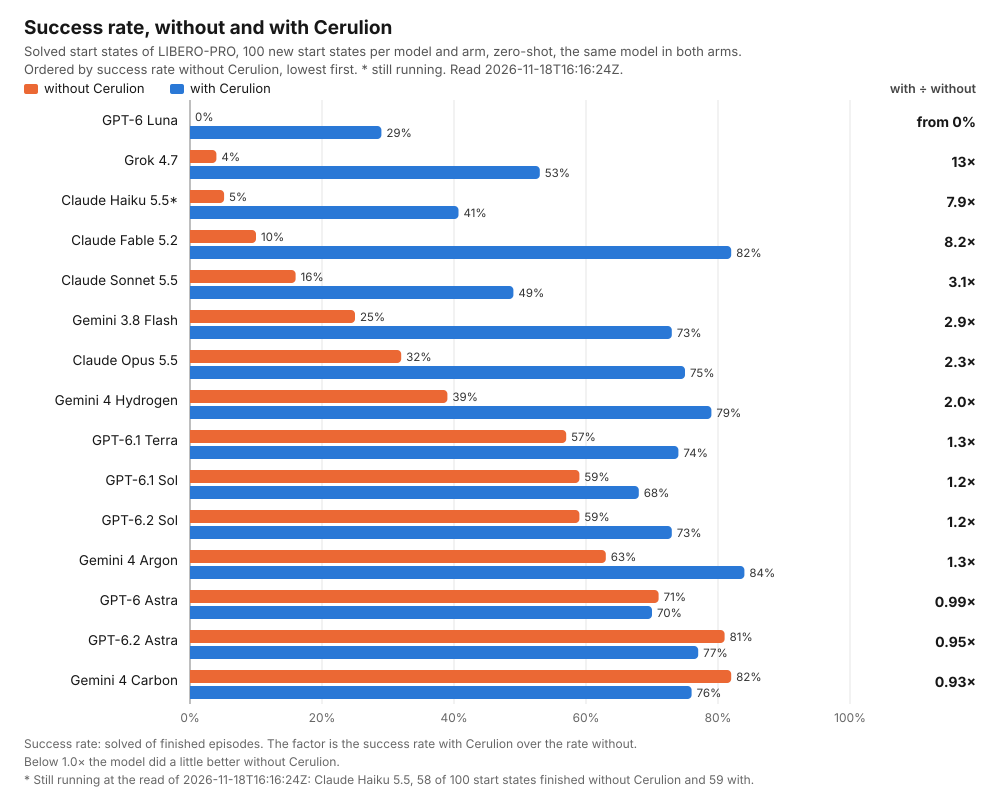

<p align="center">
  <a href="https://cerulion.com">
    <picture>
      <source media="(prefers-color-scheme: dark)" srcset="docs/media/cerulion-logo-dark.svg">
      <source media="(prefers-color-scheme: light)" srcset="docs/media/cerulion-logo-light.svg">
      
    </picture>
  </a>
</p>

<p align="center">
  <a href="LICENSE"></a>
  <a href="https://crates.io/crates/cerulion_cli"></a>
  <a href="https://github.com/cerulion-inc/cerulion/actions/workflows/ci.yml"></a>
  <a href="https://www.rust-lang.org/"></a>
  <a href="https://docs.cerulion.com"></a>
  <a href="https://discord.gg/dqKFecngPy"></a>
</p>

**Cerulion is the harness for physical AI: your AI model sees and moves a robot through it, on an open-source runtime that records runs and replays them against new code.**

- **For agent builders.** Your model gets tools and facts about the robot's body over MCP, on a simulated arm in this release. Gemini 3.8 Flash solved 73 of 100 LIBERO-PRO start states with Cerulion and 25 with the benchmark's published minimal interface, on the benchmark family the harness was built on.
- **For ROS 2 teams.** The zero-copy runtime runs stock ROS 2 nodes, replays a recorded run against new code and reaches your robots from anywhere. On one Linux desktop, a 64 B transport round trip has a median of 4.07 µs on native Cerulion against 311.11 µs on ROS 2 Jazzy defaults. [The evidence and its limits](#evidence).

<p align="center">
  
</p>

One real episode, on a start state the harness was developed on. Claude Opus 5.5 works the local simulated arm and puts the bowl on the plate with one `put` call, and the benchmark's own check says solved. The frames are scene camera renders taken while the episode ran, at simulated speed, and the time before the `put` call shows as one still frame ([how this GIF was made](docs/media/README.md#assets-the-root-readme-uses)).

## Quickstart

Each trial starts from [Install](#install), and none needs another.

| You want to | Start with | Time | You need |
|---|---|---|---|
| Run ROS 2 nodes on Cerulion | [A stock talker and listener](#bring-your-ros-2-stack) | Minutes | Linux, ROS 2 Jazzy and Cerulion installed. No sign-in. |
| Catch a behavior change before it reaches a robot | [Record, replay, change one constant](#try-the-runtime) | Minutes, plus the first build | Linux or macOS, a C toolchain and a free Cerulion account. No robot or ROS 2. |
| Let your AI model work a robot | [Your model puts a bowl on a plate](#try-the-harness) | Minutes, after a one-time install of about 4 GB | macOS on Apple silicon or Linux, 5 GiB free disk, an MCP client with a model that reads images, and a free Cerulion account |
| Check the claims first | [Evidence](#evidence) | Reading only | Nothing |

The runtime and harness trials need a free Cerulion account. The CLI signs in once on each machine, and the account then pairs your robots and computers with no addresses to set.

| Status | What |
|---|---|
| Works today (2.1.0) | The runtime and the `cerulion` CLI on Linux and macOS, and `rmw_cerulion` for ROS 2 Jazzy on Linux. A [separate Linux archive](docs/install.md#what-the-install-script-does) carries it for Lyrical, tested in CI but not on a robot. |
| Experimental | The harness, on a simulated arm only. |
| Early access | The hosted Cerulion MCP (closed source) and Cerulion Studio. |
| Not supported | Windows. SROS2. Cerulion topics in `ros2 topic list` and rqt. A packaged `rmw_cerulion` for macOS. |

## Install

Cerulion runs on Linux (x86_64 or ARM64, glibc 2.31 or later, such as Ubuntu 20.04) and macOS (Intel or Apple silicon). Windows is not supported.

Release builds send coarse usage events ([what they carry](docs/telemetry.md)). To opt out before your first command, run `export DO_NOT_TRACK=1`.

```bash
curl -fsSL https://raw.githubusercontent.com/cerulion-inc/cerulion/main/tools/scripts/install.sh | sh && . "$HOME/.cerulion/env"
cerulion --version
cerulion login
```

The script installs the latest stable release, 2.1.0 today, so `cerulion --version` prints `cerulion 2.1.0` or a later version. `cerulion login` prints a URL and a code to enter there from a browser on any device, then `Signed in as <account id>.` If a step fails, `cerulion doctor` prints a `fix:` line for each problem.

**Account.** It is free, and the CLI signs in once on each machine so the account can pair your robots and computers. After that, the account check needs no network, but the first node build and the first simulator start download what they need. A few local commands, such as `doctor` and `completions`, skip the sign-in ([full list](docs/user-api.md#cerulion-connect--rcp--login--logout--account)).

**License.** The runtime is [AGPL-3.0-only](LICENSE) and free for internal use, research and evaluation. Four client crates are MIT OR Apache-2.0, and a [commercial license](docs/legal/COMMERCIAL.md) covers uses the AGPL does not fit ([License](#license)).

<details>
<summary>What the installer changes, how to read it first, and how to remove it</summary>

The installer checks the release's SHA-256, installs Rust 1.95 or newer if needed, puts the programs and the harness in `~/.cerulion/bin`, links the programs into `~/.local/bin` and adds one line to your shell startup files (`--no-modify-path` skips both). [Installation details](docs/install.md#what-the-install-script-does) list every step.

To read the script before it runs, download it, read it, then run it. `--version v2.1.0` installs that release instead of the latest one:

```bash
curl -fsSLO https://raw.githubusercontent.com/cerulion-inc/cerulion/main/tools/scripts/install.sh
less install.sh
sh install.sh --version v2.1.0 && . "$HOME/.cerulion/env"
```

To uninstall, run the line that matches how you installed:

```bash
# after the piped install
curl -fsSL https://raw.githubusercontent.com/cerulion-inc/cerulion/main/tools/scripts/install.sh | sh -s -- --uninstall
# after sh install.sh, in the folder that holds install.sh
sh install.sh --uninstall
```

An uninstall removes the programs and keeps your sign-in, settings, each harness copy (about 4 GB) and Rust ([Uninstall](docs/install.md#uninstall)).

A usage event carries a command's name, exit code and duration, with your account id after sign-in, never arguments, paths or message contents. `cerulion telemetry off` stops the events on this machine, and a `--network off` run sends none ([every event](docs/telemetry.md)).

</details>

<details>
<summary>Homebrew, Debian and Ubuntu (APT), or crates.io</summary>

```bash
brew tap cerulion-inc/cerulion
brew install cerulion-inc/cerulion/cerulion
```

If Homebrew refuses to load the formula from this tap, run `brew trust --formula cerulion-inc/cerulion/cerulion` and try again.

For Debian and Ubuntu, [APT installation](docs/packaging/apt.md#apt-installation) has the recipe. It checks the archive key's fingerprint before it trusts the key.

```bash
cargo install --locked cerulion_cli cerulion_netd
```

This build has no harness, `cerulion-connectd`, `cerulion-remoted` or telemetry key. The [harness guide](docs/harness.md#try-it) says how to point it at a harness, and [CONTRIBUTING](.github/CONTRIBUTING.md) covers the full source build. [Installation details](docs/install.md) cover Rust on Homebrew and Debian, the ROS 2 libraries in each package, fish, and moving a workspace from Cerulion 2.0.

</details>

## Try the runtime

Record a small robot program, replay it, then change one constant and see which output changed. No robot, simulator or ROS 2 is needed.

**You need** Cerulion [installed and signed in](#install) and a C toolchain (`sudo apt-get install -y build-essential` on Debian or Ubuntu, `xcode-select --install` on macOS).


A 39.6 s recording of the commands below on Cerulion 2.1.0, after an off-screen sign-in and warm-up build; the `laser_scanner` build plays 16 times faster, the two `safety_controller` builds 4 times faster and the recording run 2 times faster ([how it was recorded](docs/media/README.md#assets-the-root-readme-uses)).

A synthetic laser scanner reports an obstacle 0.3 m away for two seconds, then a clear path for two seconds, and repeats. A safety controller publishes a forward velocity `x` of `0.3` on a clear path and `0.0` when an obstacle is closer than 0.5 m.

**1. Create and build the workspace.** The first node build downloads the runtime's dependencies and compiles them, so it takes a few minutes.

```bash
cerulion workspace create safety_demo --starter obstacle_avoidance
cd safety_demo
cerulion node build laser_scanner --release
cerulion node build safety_controller --release
```

Each build ends with `Built 'laser_scanner'` or `Built 'safety_controller'`.

**2. Record a run.** `--network off` keeps it on this machine. Without it, other computers on your account can read a run's topics.

```bash
cerulion graph run obstacle_avoidance --release --record --network off
# wait about five seconds, then press Ctrl+C in this terminal
```

The run prints the first two lines, and Ctrl+C prints the last once the recording is written:

```text
<time>  WARN local execution selected: this run is LOCAL-ONLY; ...
graph 'obstacle_avoidance' running: 2 node(s) in 2 process(es); press Ctrl+C to stop
^Crecording written to recordings/obstacle_avoidance_<time>.mcap
```

`<time>`, `<n>` and `<f>` change from run to run, and `...` marks a cut line. A WARN line about a dropped queued scan or a missed `promise_within_ms` deadline does not change the verdicts.

**3. Replay the recording against the same code.**

```bash
BAG=$(ls -t recordings/*.mcap | head -n 1)
cerulion bag play "$BAG" --resim all --verify
```

```text
replay PASS: recordings/obstacle_avoidance_<time>.mcap (<n> tick(s) replayed, 2/2 topic(s) matched byte-for-byte and were credited)
```

It exits 0: on the recorded inputs, your nodes produce the recorded outputs. That is your first success.

**4. Change one constant and replay the same recording.** The first line sets the clear-path speed to `0.25`.

```bash
perl -pi -e 's/else \{ 0\.3 \}/else { 0.25 }/' nodes/safety_controller/src/lib.rs
cerulion node build safety_controller --release
cerulion bag play "$BAG" --resim all --verify
```

```text
FRAME-CONTENT DIVERGENCE: recordings/obstacle_avoidance_<time>.mcap
  <n> tick(s) replayed; 1/2 topic(s) matched and were credited; 1 violation(s):
  - /obstacle_avoidance/safety_controller/linear_velocity [byte-mismatch]: frame <f> on '/obstacle_avoidance/safety_controller/linear_velocity' differs at x: recorded 0.3, replayed 0.25 (recorded 64 B, replayed 64 B)
  Topics passed: 1/2
```

It exits 1 and names the topic, the field and both values: on the same sensor inputs, the changed controller commands a different speed. In CI, that exit code stops the change before it reaches a robot. [Bags and replay](docs/bag.md) explains every exit code and verdict line, and `--tolerance` for inexact data.

If this worked for you, a [star](https://github.com/cerulion-inc/cerulion) helps other robotics engineers find Cerulion.

<details>
<summary>Watch the controller while it runs</summary>

During step 2, run `CERULION_NETWORK=off cerulion topic echo /obstacle_avoidance/safety_controller/linear_velocity` in a second terminal in `safety_demo`. Stop it before you stop the run.

</details>

<details>
<summary>Let your coding agent run this trial</summary>

```text
Run Cerulion's record-and-verify trial with me, in your own terminal. Ask before you install anything, and give me any system install command a step needs.
1. If cerulion --version fails or prints a version older than 2.1.0, ask me, then run: curl -fsSL https://raw.githubusercontent.com/cerulion-inc/cerulion/main/tools/scripts/install.sh | sh && . "$HOME/.cerulion/env" (if a later command cannot find cerulion, run . "$HOME/.cerulion/env" in it first)
2. Run cerulion doctor --check account.login. If it fails, apply its fix: line. When the fix is cerulion login, run it in the background and show me its URL and code.
3. Run cerulion workspace create safety_demo --starter obstacle_avoidance. In safety_demo, run cerulion node build laser_scanner --release, then cerulion node build safety_controller --release.
4. Start the run in the background and save its PID: cerulion graph run obstacle_avoidance --release --record --network off > run.log 2>&1 & echo $! > run.pid
5. Five seconds after run.log shows "running", run kill -TERM "$(cat run.pid)" and wait until run.log shows "recording written to <path>".
6. Run cerulion bag play <path> --resim all --verify and confirm that it prints replay PASS.
7. Change else { 0.3 } to else { 0.25 } in nodes/safety_controller/src/lib.rs, rebuild that node, verify the same recording again, and explain the "differs at x" line.
```

</details>

Next: the [getting-started tutorial](docs/tutorials/01-getting-started.md) writes nodes from scratch, and the [perception example](examples/perception/) turns a camera recording into a tolerance check.

### Bring your ROS 2 stack

Your ROS 2 nodes keep their APIs, executors and source: `cerulion ros2 run` runs `ros2 run` with `rmw_cerulion` as the middleware. This trial needs Linux with ROS 2 Jazzy and Cerulion [installed](#install), and no sign-in. First, install the stock demo nodes if you do not have them:

```bash
sudo apt-get install ros-jazzy-demo-nodes-cpp
```

Then start a talker and a listener in two terminals:

```bash
source /opt/ros/jazzy/setup.bash && cerulion ros2 run demo_nodes_cpp talker
```

```bash
source /opt/ros/jazzy/setup.bash && cerulion ros2 run demo_nodes_cpp listener
```

The listener prints `I heard: [Hello World: <n>]` for each message it gets from the talker over `rmw_cerulion`.

`cerulion topic list` shows the topics after you sign in, but `ros2 topic list` and rqt do not. A publisher that copies keeps copying until you move it to loans. SROS2 is not supported: `ROS_SECURITY_ENABLE=true` does not secure a Cerulion transport, so keep a stack that needs SROS2 on its current middleware.

**A replayed ROS 2 process (`cerulion ros2 run --replay-deliveries`) publishes live and still drives any device it writes to directly, such as a serial port or CAN bus, so run it where none reaches a live robot** ([ROS 2 replay](docs/ros2_replay.md)).

Next: [the `cerulion ros2` commands](docs/ros2_compatibility.md#start-inspect-bridge-and-migrate-a-ros-2-stack) launch, inspect, bridge and migrate your own stack. `rmw_cerulion` is validated on Jazzy and tested in CI on Foxy, Galactic, Humble and Lyrical ([compatibility](docs/ros2_compatibility.md)). [`ros2:` entries](docs/user-api.md#ros2-entries-stock-ros-2-nodes-in-the-same-graph) run ROS 2 processes beside native nodes, the [ROS 2 guide](https://docs.cerulion.com/cerulion/guides/bridge-ros2) covers loans, and the [MoveIt 2 example](examples/moveit_hero/) runs an unmodified planning stack in Docker.

### Runs on real hardware

<p align="center">
  
</p>

Cerulion Studio (early access) streams a real six-axis arm's ROS 2 and MoveIt data through Cerulion into a live 3D view, with a phone video of the arm inset. No AI model drives this arm, and the pauses between moves are cut.

## Try the harness

**Experimental: in this release the harness drives a simulated arm, not a physical robot.** Your model gets tools to look through the robot's cameras, move, touch, grasp and set things down, and each call answers with what the robot measured.

**You need:**

- Cerulion 2.1.0 or later, [installed and signed in](#install) with your free account.
- macOS on Apple silicon, or Linux on x86_64 or ARM64, with `git` and `curl`. On Ubuntu, also `sudo apt-get install libosmesa6 libegl1 libgl1 libglib2.0-0`. No GPU.
- 5 GiB of free disk: the first run installs about 4 GB and refuses to start with less.
- An MCP client whose model calls tools and reads images, such as Claude Code. Your provider bills the model calls, and the local simulator spends no sim credits.

If you have early access, the [hosted arm](#give-your-model-cerulion) needs no install and runs on sim credits.

**1. Start the simulator and leave it running.** The first run takes minutes.

```bash
cerulion rcp --sim --http 127.0.0.1:8765
```

It is ready when it logs `serving MCP at http://127.0.0.1:8765/mcp`.

**Keep `--http` on a loopback address.** Anyone who can reach it can start simulators on your machine and watch every episode.

**2. Connect your client and ask for a task.** In Claude Code, run both lines in one folder. The first adds the server for that folder only.

```bash
claude mcp add --transport http cerulion-sim http://127.0.0.1:8765/mcp
claude "With cerulion-sim, put the bowl on the plate, and give me the link to watch the episode."
```

In another MCP client, add `http://127.0.0.1:8765/mcp` as a streamable HTTP server and reconnect. A client that keeps no MCP session names its episode in the URL, such as `http://127.0.0.1:8765/mcp?episode=a`.

**3. Watch the episode** at the link your model gives you, `http://127.0.0.1:8765/view/<episode id>`. It shows the camera pictures, each tool call and result, and the model's claim, then the benchmark's own check: `Benchmark verdict: solved` or `Benchmark verdict: not solved`. The model can fail.

In the episode above, the reply from Claude Opus 5.5 began like this. Your model chooses its own words.

```text
The bowl is on the plate, and the task is done.
...
- **Watch it here:** http://127.0.0.1:8765/view/<episode id>
```

**4. Stop the simulator** with Ctrl+C in its terminal.

`--task open-drawer` and `--task soup-in-basket` set up the other two tasks, all start states the harness was developed on. Apart from usage telemetry, the simulator reaches no Cerulion service. Apple's OpenGL renders slightly different pictures on macOS, so an episode there is a try, not a reproduction.

<details>
<summary>Let your coding agent start the simulator</summary>

```text
Start Cerulion's local simulated arm for me, in your own terminal. Ask before you install anything, and give me any system install command a step needs.
1. If cerulion --version fails or prints a version older than 2.1.0, ask me, then run: curl -fsSL https://raw.githubusercontent.com/cerulion-inc/cerulion/main/tools/scripts/install.sh | sh && . "$HOME/.cerulion/env" (if a later command cannot find cerulion, run . "$HOME/.cerulion/env" in it first)
2. Run cerulion doctor --check account.login. If it fails, apply its fix: line. When the fix is cerulion login, run it in the background and show me its URL and code.
3. Run cerulion rcp --sim --http 127.0.0.1:8765 > rcp-sim.log 2>&1 & echo $! > rcp-sim.pid
4. Wait until curl -fsS http://127.0.0.1:8765/health answers. The first run installs about 4 GB and needs 5 GiB free. If the server exits first, tell me why from rcp-sim.log.
5. Tell me to add http://127.0.0.1:8765/mcp to my MCP client as a streamable HTTP server named cerulion-sim, reconnect it and ask it to put the bowl on the plate. Tell me that kill -TERM "$(cat rcp-sim.pid)" stops the simulator.
```

</details>

To score your own model on a published start state, see [Rerun a start state](docs/evidence.md#rerun-a-start-state-against-your-own-model). The [harness guide](docs/harness.md#try-it) covers stdio and `cargo install`.

### Give your model Cerulion

The hosted Cerulion MCP is closed source and in early access, so [request access](https://docs.cerulion.com/cerulion/hindsight) first. With access it needs no install, only your account. It gives your model a simulated arm in Cerulion's cloud, analysis of your MCAP recordings and a view of your robots. The cloud arm runs on your account's sim credits, one credit for each second the simulator is held open. `sim_end` stops it and reports the sim credits charged.

```bash
claude mcp add --transport http cerulion https://mcp.cerulion.com/mcp/cerulion
```

Run `/mcp` in Claude Code, pick `cerulion`, sign in and ask: "Start the simulated arm, put the bowl on the plate, then stop it with sim_end and tell me the sim credits charged." [The hosted Cerulion MCP](docs/harness.md#the-hosted-cerulion-mcp) lists its tools and limits.

## Evidence

Every figure below is copied from a results package in this repository.

### Harness results

Each of 16 models ran the same 100 LIBERO-PRO start states twice: with Cerulion, and without it on the benchmark's published minimal interface of three tools (arXiv:2610.30051). A start state is one task, such as "put the bowl on the stove", from one starting scene. Both runs had the same simulator, budget (80 model replies, 900 control steps) and success check.

- **The main test, declared before the first episode.** Gemini 3.8 Flash solved 73 of 100 start states with Cerulion and 25 without (2.9 times as many; exact two-sided sign test p = 1.10e-11).
- **All 16 models.** With Cerulion, 12 solved more and 4 solved fewer. After Holm's correction, the gain is established for 9 of 16.
- **Cost.** Gemini 3.8 Flash's model cost per solved start state, at list prices, was 6.67 USD without Cerulion and 0.48 USD with it. Part of that gap is caching.

<picture>
  <source media="(prefers-color-scheme: dark)" srcset="docs/media/harness-success-rate-dark.svg">
  <source media="(prefers-color-scheme: light)" srcset="docs/media/harness-success-rate-light.svg">
  
</picture>

Four limits change what these results mean:

- **One benchmark family.** The result is on the benchmark family the harness was built and checked on. The 100 start states are new, but their 25 task rows are ones the harness was developed on.
- **More than tools.** The run with Cerulion also reads the simulated robot's calibration record, so the comparison is the whole package against the published minimal interface.
- **Not every model gains.** With Cerulion, 4 of 16 models solved fewer, the 4 with the highest scores without it, with no difference shown for each.
- **Simulation only.** Nothing here measures a model on a physical robot.

### Latency

Round trips, **p50 / p99**, on one x86-64 Linux desktop (24-core Intel Core Ultra 9 285K, performance governor, no real-time tuning), 2026-09-16, at a nominal 100 Hz offered load. This is transport only: no payload byte is written inside the timed window, so a node's own work adds to it. The Cerulion columns include always-on Flashback, the default recorder.

| Payload | Cerulion multi-process (default) | Cerulion single process | ROS 2 Jazzy, `rmw_fastrtps_cpp` defaults | ROS 2 Jazzy, composed with intra-process |
|---|---:|---:|---:|---:|
| 64 B | 4.07 µs / 6.61 µs | 2.69 µs / 9.41 µs | 311.11 µs / 568.17 µs | 24.64 µs / 31.47 µs |
| 1 MiB | 4.08 µs / 7.38 µs | 2.76 µs / 10.74 µs | 11.0 ms / 43.4 ms | 29.79 µs / 36.99 µs |
| 16 MiB | 4.43 µs / 10.45 µs | 2.80 µs / 14.23 µs | 103.9 ms / 156.9 ms | 33.41 µs / 37.34 µs |

- At 1 MiB the ROS 2 defaults median is 2,687× the Cerulion default median.
- From 1 MiB up, the ROS 2 defaults median is longer than the 10 ms pacing interval (11.0 ms at 1 MiB), so those requests overlap.
- The composed lane runs every node in one process. Compare it with the single-process column.
- ROS 2 Jazzy on `rmw_cerulion`, three nodes in three processes with loaned publishing and loaned takes, reads **11.12 µs p50 / 37.21 µs p99** at 1 MiB. A publisher that still copies does not get these figures.

<picture>
  <source media="(prefers-color-scheme: dark)" srcset="docs/media/native-rtt-dark.svg">
  <source media="(prefers-color-scheme: light)" srcset="docs/media/native-rtt-light.svg">
  
</picture>

The table and this chart are from one desktop, not a guarantee, and the largest ratio is against ROS 2 defaults, not a tuned ROS 2 setup.

<details>
<summary>Across platforms: Linux x86_64, NVIDIA Jetson and Apple Silicon</summary>

<picture>
  <source media="(prefers-color-scheme: dark)" srcset="docs/media/platform-rtt-dark.svg">
  <source media="(prefers-color-scheme: light)" srcset="docs/media/platform-rtt-light.svg">
  
</picture>

The Apple M4 row is a later build, Cerulion 2.0.0 on macOS 27.2.1 ([macOS two-process data wake](docs/PERFORMANCE.md#macos-two-process-data-wake)).

</details>

The [evidence page](docs/evidence.md) has the rest: the cost of a solved start state for every model, the other limits (a filtered baseline, more false claims per failure, one draw each), a rerun of a start state against your own model, and every results package.

## Build on the runtime

### Write your own node

This is the controller you changed, without its comments, lint line and test module. You write a typed input, a typed output and `tick`. The graph file does the wiring, and the runtime does scheduling, transport and recording, with no executor, callbacks or spin loop.

```rust
use cerulion_core::prelude::*;
use native_ros2_messages::geometry_msgs::Vector3;
use native_ros2_messages::sensor_msgs::LaserScan;

#[cerulion_node]
#[derive(Default)]
pub struct SafetyControllerNode {
    #[input(trigger, depth = 1, expect_within_ms = 100)]
    scan: LaserScan,
    #[output(promise_within_ms = 100)]
    linear_velocity: Vector3,
}

#[cerulion_node_impl]
impl SafetyControllerNode {
    fn tick(&mut self) -> Result<(), NodeError> {
        let ranges = self.scan.ranges();
        let obstacle_close = ranges.is_empty() || ranges.iter().any(|&r| r.is_nan() || r < 0.5);
        self.linear_velocity.x = if obstacle_close { 0.0 } else { 0.3 };
        Ok(())
    }
}
```

`#[input(trigger)]` runs `tick` when a scan arrives, and the two deadlines count misses, so a stalled sensor shows in counters. [Define a node](https://docs.cerulion.com/cerulion/guides/define-a-node), the [API reference](docs/user-api.md) and [Python](docs/python.md) cover periodic nodes, backpressure, parameters and Python nodes.

### Capture failures with Flashback

A running graph keeps about the last 30 seconds in memory by default. A fault, such as a worker that dies or a topic that stalls, writes that window to disk as a recording, and so does this command from another shell:

```bash
cerulion flashback --note "controller stopped late"
```

[Flashback](docs/flashback.md) lists the triggers, which captures re-execute and how to turn it off.

### How Cerulion fits together

Each node runs when its inputs are ready, and nodes exchange loaned shared-memory messages. Robots on your account are reached directly or through a relay ([networking](docs/networking.md)).

<details>
<summary>Diagrams: the architecture and the development loop</summary>

<picture>
  <source media="(prefers-color-scheme: dark)" srcset="docs/media/architecture-flow-dark.svg">
  <source media="(prefers-color-scheme: light)" srcset="docs/media/architecture-flow-light.svg">
  
</picture>

<picture>
  <source media="(prefers-color-scheme: dark)" srcset="docs/media/development-loop-dark.svg">
  <source media="(prefers-color-scheme: light)" srcset="docs/media/development-loop-light.svg">
  
</picture>

</details>

Guides: [Execution](https://docs.cerulion.com/cerulion/execution-order) · [Multi-process graphs](https://docs.cerulion.com/cerulion/guides/run-multi-process) · [Remote robots](https://docs.cerulion.com/cerulion/guides/network-and-remote-robots) · [Remote access](docs/remote_plane.md) · [Inspect topics](https://docs.cerulion.com/cerulion/guides/inspect-topics) · [Record and replay](https://docs.cerulion.com/cerulion/guides/record-and-replay)

## Examples

| Example | What it shows |
|---|---|
| [Obstacle avoidance](examples/obstacle_avoidance/) | Typed nodes, a live controller and replay verification. |
| [Camera pipeline](examples/camera_pipeline/) | In-place image generation and a data-triggered detector. |
| [Perception regression](examples/perception/) | Image-derived detections and a repeatable tolerance failure. |
| [V4L2 camera](examples/v4l2_camera/) | A Linux camera driver node and a brightness meter. Needs a camera. |
| [RealSense](examples/realsense/) | Color, depth and a nearest-obstacle range. Needs a RealSense. |
| [MoveIt 2](examples/moveit_hero/) | An existing ROS 2 planning stack on `rmw_cerulion`. |
| [Go2 quadruped](examples/go2/) | A DDS robot bridged, its camera transcoded, and teleop with a safety mux. |

## Roadmap

The direction is **review for robot changes**: recordings, simulations and behavioral evidence in review before a change reaches a robot. The [changelog](CHANGELOG.md) records each release. Propose a use case or a feature in [GitHub Discussions](https://github.com/cerulion-inc/cerulion/discussions).

<details>
<summary>What is next, by area</summary>

| Area | What's next |
|---|---|
| **Faster execution** | Chain-fused nodes that pass data directly within a process, nanosecond-scale handoff as a measured target, and lower macOS cross-process wake-up latency. |
| **C++** | First-class node authoring and a client library, with clear boundaries for zero-copy access, scheduling and reproducible execution. |
| **Robot building blocks** | Native transforms and URDF, parameters that change while a graph runs (typed parameters set at graph load already ship), and lifecycle, each with a path from ROS 2. |
| **Flashback from node code** | A node declares an incident itself, so a bumper or a grasp check saves the moment it sees. |
| **Services and actions** | A native request and response API on the shipped deterministic service layer, then actions with feedback, cancellation and streaming replies. |
| **Pull-request verification** | A GitHub reviewer that runs recorded regressions and cloud simulations, reports behavioral differences and keeps the evidence with the change. |
| **Scenario libraries** | User-defined environments and expected behavior, failure bags promoted to regression cases, and generated stress scenarios. |
| **Agents and inspection** | A tighter loop of inspecting data, changing code and replaying, with runs, recordings and reports side by side. |
| **Platforms and interoperability** | Windows support, broader hardware validation and easier exchange with robotics data tools. |
| **Remote access** | Hardened account-based pairing: robot-side provisioning, hosted account services and grant management across owned and shared robots. |

</details>

## Get help and contribute

- Questions and designs: [Discussions](https://github.com/cerulion-inc/cerulion/discussions). Real-time help: [Discord](https://discord.gg/dqKFecngPy).
- Bugs you can reproduce: [Issues](https://github.com/cerulion-inc/cerulion/issues). Vulnerabilities: the [security policy](.github/SECURITY.md), not a public issue.
- Read [Contributing](.github/CONTRIBUTING.md) before you send code or docs. Contributions come in under the [contributor license agreement](.github/CLA/individual.md): you keep your copyright and grant Cerulion a license to offer the code under AGPL-3.0 and commercial terms.

[Documentation](https://docs.cerulion.com) · [Guides](https://docs.cerulion.com/cerulion/guides) · [API reference](docs/user-api.md) · [Android build support](docs/android.md) · [Code of conduct](.github/CODE_OF_CONDUCT.md) · [Talk to the founders](https://cerulion.com/demo)

Cerulion is built by [Cerulion Inc.](https://cerulion.com), a YC S24 company. Commercial questions: licensing@cerulion.com.

If Cerulion is useful to you, a [star](https://github.com/cerulion-inc/cerulion) helps other robotics engineers and agent builders find it.

## License

Cerulion is [AGPL-3.0-only](LICENSE), with a [commercial license](docs/legal/COMMERCIAL.md) available. Internal use on your own robots, research and evaluation are free, with no obligation to release your source. If you convey Cerulion, you must offer its corresponding source (AGPL sections 4 to 6). If you modify it and users interact with your version over a network, you must offer them its source (AGPL section 13). The commercial license covers a closed-source product that includes or links the AGPL code, and a network service for third parties that does not offer them its source. The client crates in `crates/cerulion_wire`, `crates/cerulion_link`, `crates/cerulion_ops_proto` and `crates/cerulion_pairing` are MIT OR Apache-2.0, so a program that uses only them needs no commercial license.

## Citing Cerulion

Use GitHub's **Cite this repository** button or [CITATION.cff](CITATION.cff):

```bibtex
@software{cerulion,
  author  = {Sharma, Lakshay and Kariyawasam, Raveen and {Cerulion Inc. and contributors}},
  title   = {Cerulion},
  year    = {2026},
  version = {2.1.0},
  url     = {https://github.com/cerulion-inc/cerulion}
}
```
