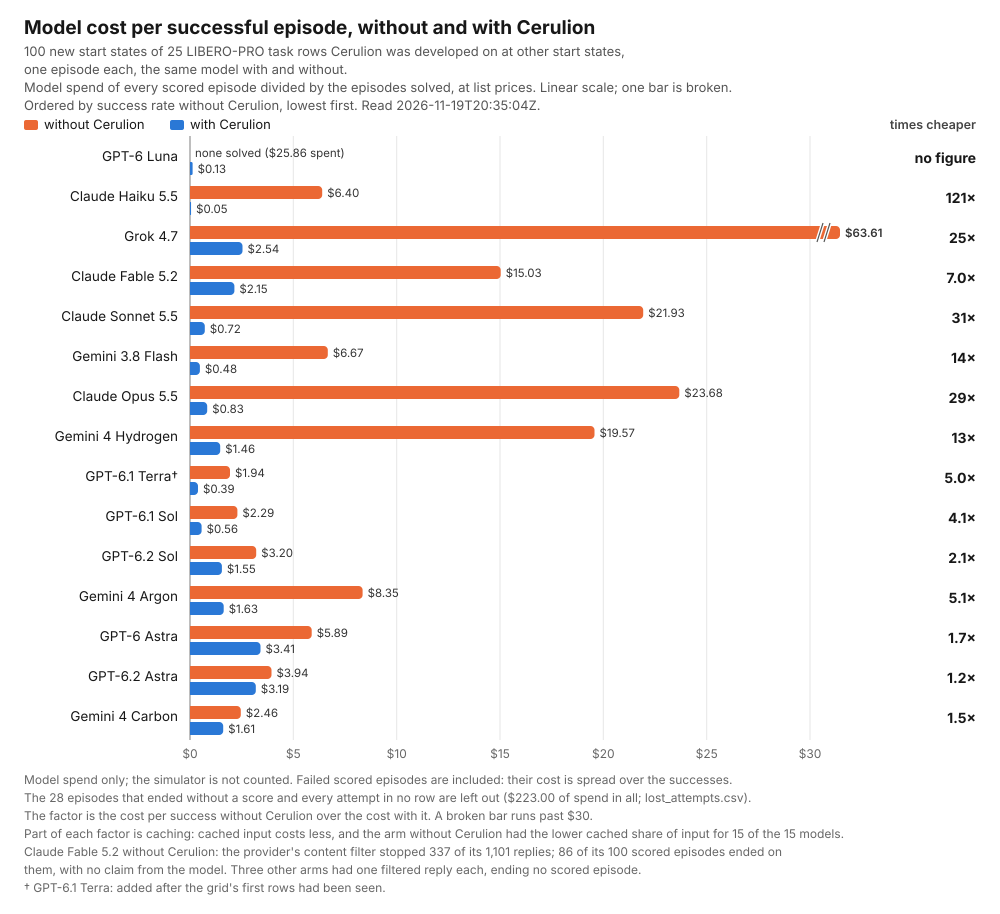
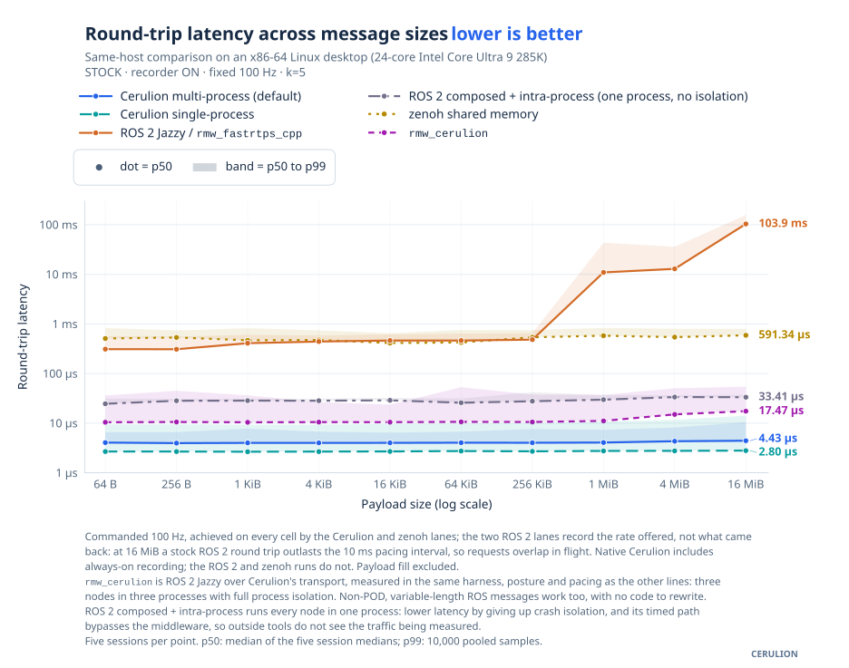

<p align="center">
  <a href="https://cerulion.com">
    <picture>
      <source media="(prefers-color-scheme: dark)" srcset="docs/media/cerulion-logo-dark.svg">
      <source media="(prefers-color-scheme: light)" srcset="docs/media/cerulion-logo-light.svg">
      
    </picture>
  </a>
</p>

<p align="center">
  <a href="LICENSE"></a>
  <a href="https://crates.io/crates/cerulion_cli"></a>
  <a href="https://www.rust-lang.org/"></a>
  <a href="https://docs.cerulion.com"></a>
</p>

**Cerulion (YC S24) is the harness for physical AI: the tools and the facts about a robot's body that a general AI model needs to control a robot it was never trained on.** It is built on an open-source, zero-copy robot runtime that records runs, replays failures against new code and reaches your robots from anywhere. The runtime is ROS 2 compatible.

You can try two things today, with no robot: record robot code and replay the same inputs after a change, or give your own model the harness's tools on a simulated arm (experimental, simulation only).

On LIBERO-PRO, a simulated benchmark the harness was built on, Gemini 3.8 Flash solved 73 of 100 start states with Cerulion and 25 without. Of 16 models, 12 solved more with Cerulion and 4 solved fewer. On one Linux desktop, a 1 MiB round trip has a median of 4.08 µs on Cerulion and 11.0 ms on ROS 2 Jazzy defaults. [See the evidence and its limits](#evidence).

<p align="center">
  
</p>

A real six-axis arm's ROS 2 and MoveIt topics, streamed through Cerulion into a live 3D view, with a phone video of the arm inset. No AI model drives the arm here, and pauses are cut.

## Quickstart

Pick your row. Each path is complete on its own, and both trials start from the same [Install](#install).

| You are | Start here | Time | You need |
|---|---|---|---|
| A ROS 2 engineer | [Try the runtime](#try-the-runtime): record and replay-verify a robot program, then bring your ROS 2 stack | Minutes, plus a few for the first build | Linux or macOS, a C toolchain, a free account. No robot or ROS 2 for the first trial. |
| An agent builder who wants a model to control a robot | [Try the harness](#try-the-harness): your model works a simulated arm over MCP | Minutes, after a one-time install of about 4 GB | macOS on Apple silicon or Linux, 5 GB free disk, an MCP client whose model reads images, a free account |
| An evaluator who wants the evidence first | [Evidence](#evidence): results, latency and limits | Reading only | Nothing to install |

## Install

Cerulion runs on Linux (x86_64 or ARM64, glibc 2.31 or later, such as Ubuntu 20.04 and later) and macOS (Intel or Apple silicon). Windows is not supported.

```bash
curl -fsSL https://raw.githubusercontent.com/cerulion-inc/cerulion/main/tools/scripts/install.sh | sh && . "$HOME/.cerulion/env"
cerulion login
```

- **What the installer changes.** It downloads the latest stable release, checks its SHA-256 checksum and installs Rust 1.95 or newer through rustup if needed. It puts the programs and the harness in `~/.cerulion/bin`, links the programs into `~/.local/bin` and adds one line to your shell startup files. `sh -s -- --no-modify-path` leaves your startup files and `~/.local/bin` alone, and `sh -s -- --uninstall` removes the install. [Read the script](tools/scripts/install.sh), or the [installation details](docs/install.md) for every change.
- **Why an account.** The `cerulion` commands run under a free Cerulion account (`cerulion doctor` does not need one). The account pairs your robots and computers, so they find each other with no addresses to set. `cerulion login` prints a link and a code, and you approve this machine once in a browser on any machine. Local commands then work offline.
- **Telemetry.** Release builds send coarse usage events, such as a command's name, exit code and duration, with your account id after sign-in. They never carry arguments, paths, topic names or message contents. `cerulion telemetry off` or `DO_NOT_TRACK=1` stops them, and a `--network off` run sends none. [Usage telemetry](docs/telemetry.md) lists every event.
- **License.** [AGPL-3.0-only](LICENSE). Running Cerulion on your own robots inside your organization is free and asks you to publish nothing, and research and evaluation are free. To ship it in a closed-source product, or to offer it as a network service without publishing your source, you need the [commercial license](docs/legal/COMMERCIAL.md). Four client crates are MIT OR Apache-2.0.

If a step fails, `cerulion doctor` checks this machine and prints a fix for each problem. Ask in [GitHub Discussions](https://github.com/cerulion-inc/cerulion/discussions) or on [Discord](https://discord.gg/dqKFecngPy).

<details>
<summary>Homebrew</summary>

```bash
brew tap cerulion-inc/cerulion
brew install cerulion-inc/cerulion/cerulion
```

If Homebrew refuses to load the formula from this tap, run `brew trust --formula cerulion-inc/cerulion/cerulion` and try again.

</details>

<details>
<summary>Debian or Ubuntu (APT, with a pinned key)</summary>

```bash
sudo apt-get update && sudo apt-get install -y ca-certificates curl gnupg
keyring=$(mktemp) &&
  curl -fsSL https://apt.cerulion.com/cerulion-archive-keyring.gpg -o "$keyring" &&
  [ "$(gpg --batch --show-keys --with-colons "$keyring" | awk -F: '$1 == "pub" { p=1; next } p && $1 == "fpr" { print toupper($10); p=0; next } $1 == "sub" { p=0 }' | sort -u)" = "$(printf '%s\n' 953C69FD279D9256FA4B71C5DA5FDE5D0DC6D91B | sort -u)" ] &&
  sudo install -m 0644 "$keyring" /usr/share/keyrings/cerulion-archive-keyring.gpg &&
  echo "deb [arch=$(dpkg --print-architecture) signed-by=/usr/share/keyrings/cerulion-archive-keyring.gpg] https://apt.cerulion.com stable main" | sudo tee /etc/apt/sources.list.d/cerulion.list >/dev/null &&
  rm -f "$keyring" &&
  sudo apt-get update && sudo apt-get install cerulion
```

Each step runs only if the one before it succeeded. The check compares the key's primary fingerprint with the pinned one, as the [APT distribution page](docs/packaging/apt.md) does in a longer form.

</details>

<details>
<summary>crates.io or source</summary>

```bash
cargo install --locked cerulion_cli cerulion_netd
```

This build has no harness, `cerulion-connectd` or `cerulion-remoted` beside it, and no telemetry key. The [harness guide](docs/harness.md#try-it) says how to point it at a harness. The [installation guide](https://docs.cerulion.com/cerulion/installation) and [CONTRIBUTING](.github/CONTRIBUTING.md) cover the full source build.

</details>

Rust on Homebrew and Debian, the ROS 2 libraries in each package, fish, and moving a workspace from Cerulion 2.0 are in the [installation details](docs/install.md).

## Try the runtime

Record a small robot program, replay it against the same code, then change one constant and see which output changed. No robot, simulator or ROS 2 is needed.

**You need** Cerulion [installed and signed in](#install) and a C toolchain: `sudo apt-get install -y build-essential` on Debian or Ubuntu, `xcode-select --install` on macOS. The first node build compiles the runtime and takes a few minutes.

### Record and replay-verify a robot program

The starter has two nodes. A synthetic laser scanner moves an obstacle into range and out again every two seconds. A safety controller publishes a forward velocity `x` of `0.3` on a clear path and `0.0` when an obstacle is closer than 0.5 m.

**1. Create and build the workspace.**

```bash
cerulion workspace create safety_demo --starter obstacle_avoidance
cd safety_demo
cerulion node build laser_scanner --release
cerulion node build safety_controller --release
cerulion graph validate obstacle_avoidance
```

**2. Record a run.** `--network off` keeps it on this machine.

```bash
cerulion graph run obstacle_avoidance --release --record --network off
```

```text
graph 'obstacle_avoidance' running: 2 node(s) in 2 process(es); press Ctrl+C to stop
```

Wait five seconds, so the controller sees both states. Then press **Ctrl+C** in this terminal. That Ctrl+C stops the run and writes the recording:

```text
recording written to recordings/obstacle_avoidance_20260918T181449Z.mcap
```

To watch the controller while it runs, start `CERULION_NETWORK=off cerulion topic echo /obstacle_avoidance/safety_controller/linear_velocity` in a second terminal in `safety_demo`. Its `x` switches between `0.3` and `0.0`. Stop it before you stop the run.

**3. Replay the recording against the same code.**

```bash
BAG=$(ls -t recordings/*.mcap | head -n 1)
cerulion bag play "$BAG" --resim all --verify
```

The report includes this line:

```text
replay PASS: recordings/obstacle_avoidance_20260918T181449Z.mcap (<n> tick(s) replayed, <m>/<m> topic(s) matched byte-for-byte and were credited)
```

It exits 0: on the recorded inputs, your nodes produce the recorded outputs.

**4. Change one constant and replay the same recording.** The first line sets the clear-path speed in `nodes/safety_controller/src/lib.rs` to `0.25`.

```bash
perl -pi -e 's/else \{ 0\.3 \}/else { 0.25 }/' nodes/safety_controller/src/lib.rs
cerulion node build safety_controller --release
cerulion bag play "$BAG" --resim all --verify
```

This time the report names the topic, the field and both values:

```text
frame <n> on '/obstacle_avoidance/safety_controller/linear_velocity' differs at x: recorded 0.3, replayed 0.25 (recorded 64 B, replayed 64 B)
```

It exits 1. On the same sensor inputs, the changed controller commands a different speed. In CI, that verdict flags the change before it reaches a robot.

If this worked for you, a [star](https://github.com/cerulion-inc/cerulion) helps other robotics engineers find Cerulion.

<details>
<summary>What the verdict means</summary>

Cerulion runs the graph again on the recorded inputs and execution context, then compares the covered outputs with the recording. Exit 0: the frames match. Exit 1: output data differs, and the verdict names the topic, the first changed field and both values. Exit 6: the execution schedule differs. Exits 2 to 5: verification could not finish, and the error says why. Comparisons are byte-exact unless you pass `--tolerance`, such as a bounding-box overlap ([Bags and replay](docs/bag.md) lists them). `--report` writes a machine-readable verdict.

</details>

<details>
<summary>Watch it: an 80-second terminal recording</summary>


Recorded on Cerulion 2.0.0, which reports the change as a byte offset (`differs at byte 40`). Version 2.1.0 names the field and both values. The builds play 12 and 4 times faster than real time, and the run twice as fast.

</details>

<details>
<summary>Let your coding agent run this trial</summary>

```text
Run Cerulion's record-and-verify trial with me, in your own terminal. Ask before you install anything, and give me any system install command a step needs.
1. If cerulion --version fails or is older than 2.1.0, ask me, then run: curl -fsSL https://raw.githubusercontent.com/cerulion-inc/cerulion/main/tools/scripts/install.sh | sh && . "$HOME/.cerulion/env"
2. If cerulion doctor --check account.login fails, run cerulion login in the background and show me its URL and code.
3. Run cerulion workspace create safety_demo --starter obstacle_avoidance. In safety_demo, run cerulion node build <node> --release for laser_scanner and safety_controller, then cerulion graph validate obstacle_avoidance.
4. In the background: echo $$ > run.pid && exec cerulion graph run obstacle_avoidance --release --record --network off > run.log 2>&1. Five seconds after run.log shows "running", run kill -INT "$(cat run.pid)" and wait for "recording written to <path>".
5. Confirm cerulion bag play <path> --resim all --verify prints replay PASS.
6. Change 0.3 to 0.25 where nodes/safety_controller/src/lib.rs sets linear_velocity.x, rebuild that node, verify again, and explain the "differs at x" line.
```

</details>

Without `--network off`, any computer signed in to your account can read the run's topics. Next: write nodes from scratch with the [getting-started tutorial](docs/tutorials/01-getting-started.md), or turn a camera recording into a tolerance check with the [perception example](examples/perception/).

### Bring your ROS 2 stack

**You need** Linux with ROS 2 Jazzy (Ubuntu 24.04) and its setup file sourced. The Linux packages carry the Jazzy `rmw_cerulion` library. The macOS packages carry none.

**If you control startup**, start your launch file or executable through Cerulion, with your own package and file names:

```bash
source /opt/ros/jazzy/setup.bash
cerulion ros2 launch my_robot_bringup camera.launch.py
cerulion ros2 run my_robot_drivers imu_node
```

Your nodes keep their ROS 2 APIs, executors and source, and a publisher that copies keeps copying until you move it to loans. `cerulion topic list` and `cerulion topic echo` show the topics. `ros2 topic list` and rqt do not, because the rmw's discovery is process-local. The [MoveIt 2 example](examples/moveit_hero/) runs an unmodified planning stack over `rmw_cerulion`, in Docker.

<details>
<summary>Move C++ publishers to zero-copy loans</summary>

```bash
cerulion ros2 migrate --workspace ~/ros2_ws
cerulion ros2 migrate --workspace ~/ros2_ws --write
```

The first command previews which C++ publish sites can use the loaned-message API. `--write` applies the rewrite as one commit in a clean git tree. The [ROS 2 guide](https://docs.cerulion.com/cerulion/guides/bridge-ros2) covers loaned publishing and loaned subscribing.

</details>

**If the stack is already running**, attach to its DDS topics without restarting it. Run this in a Cerulion workspace, where it writes the bridge graph, and pass this computer's IP address on the robot's network:

```bash
cerulion ros2 attach --iface <local-interface-IP>
```

`ros2:` entries in a graph file run ROS 2 processes beside native nodes. `rmw_cerulion` is validated on Jazzy and tested in CI on Foxy, Galactic, Humble and Lyrical ([compatibility](docs/ros2_compatibility.md)). **Replaying one ROS 2 process (`cerulion ros2 run --replay-deliveries`) publishes live and still drives any device it writes to directly, such as a serial port or CAN bus. Run it where neither reaches a live robot** ([ROS 2 replay](docs/ros2_replay.md)).

### Write your own node

This is the controller you changed, as the starter ships it, without its comments, its lint line and its test module. You write a typed input, a typed output and `tick`. The graph file does the wiring, and the runtime does scheduling, transport, recording and observability, with no executor, callbacks or spin loop.

```rust
use cerulion_core::prelude::*;
use native_ros2_messages::geometry_msgs::Vector3;
use native_ros2_messages::sensor_msgs::LaserScan;

#[cerulion_node]
#[derive(Default)]
pub struct SafetyControllerNode {
    #[input(trigger, depth = 1, expect_within_ms = 100)]
    scan: LaserScan,
    #[output(promise_within_ms = 100)]
    linear_velocity: Vector3,
}

#[cerulion_node_impl]
impl SafetyControllerNode {
    fn tick(&mut self) -> Result<(), NodeError> {
        let ranges = self.scan.ranges();
        let obstacle_close = ranges.is_empty() || ranges.iter().any(|&r| r.is_nan() || r < 0.5);
        self.linear_velocity.x = if obstacle_close { 0.0 } else { 0.3 };
        Ok(())
    }
}
```

`#[input(trigger)]` runs the controller when a scan arrives, and the two deadlines count misses, so a stalled sensor shows in counters. [Define a node](https://docs.cerulion.com/cerulion/guides/define-a-node), the [API reference](docs/user-api.md) and [Python](docs/python.md) cover periodic nodes, backpressure, loaned writers, typed parameters and Python nodes.

### Capture failures with Flashback

By default, a running graph on Linux or macOS keeps about the last 30 seconds in memory. A fault, such as a worker that dies or a topic that stalls, writes that window to disk as a recording. So does this command, from another shell on the robot:

```bash
cerulion flashback --note "controller stopped late"
```

`cerulion bag info` says whether a capture can be re-executed. `CERULION_FLASHBACK=off` or `cerulion graph run --no-rings` turns Flashback off, and some run shapes keep frames only ([Flashback](docs/flashback.md)). `cerulion bag record --run=obstacle_avoidance` records a graph that is already running.

## Try the harness

**Experimental: in this release the harness drives a simulated arm, not a physical robot.** Bring any model that calls tools and reads images. The harness gives it tools to look through the robot's cameras, move, touch, grasp and set things down, and answers each call with what the robot measured.

**You need:**

- Cerulion 2.1.0 or later, [installed and signed in](#install). `cerulion --version` prints the version.
- macOS on Apple silicon, or Linux on x86_64 or ARM64, with `git` and `curl`. On Ubuntu, also run `sudo apt-get install libosmesa6 libegl1 libgl1 libglib2.0-0` for the CPU renderer. No GPU.
- 5 GB of free disk. The first run installs about 4 GB.
- An MCP client whose model calls tools and reads images, such as Claude Code.

The local simulator spends no Cerulion sim credits. Your model provider bills the model calls.

### Let your model work a simulated arm

**1. Start the simulator and leave it running.** The first run takes minutes. Later runs start in seconds.

```bash
cerulion rcp --sim --http 127.0.0.1:8765
```

It is ready when `curl -fsS http://127.0.0.1:8765/health`, in a second terminal, prints `{"ok":true,...}`.

**2. Connect your client and ask for a task.** In Claude Code, run both lines in one folder. The first adds the server for that folder only.

```bash
claude mcp add --transport http cerulion-sim http://127.0.0.1:8765/mcp
claude "With cerulion-sim, put the bowl on the plate, and give me the link to watch the episode."
```

In another MCP client, add `http://127.0.0.1:8765/mcp` as a streamable HTTP server, reconnect, and ask the same thing.

**3. Watch the episode** at the link the server gives your model, `http://127.0.0.1:8765/view/<episode id>`. It shows the camera pictures and the benchmark's own verdict, and the model can fail. `http://127.0.0.1:8765/episodes` lists every episode.

**4. Stop the simulator** with Ctrl+C in its terminal.

Each MCP connection gets its own episode. The default task is `bowl-on-plate`, and `--task open-drawer` or `--task soup-in-basket` sets up the other two. All three are start states the harness was developed on, not published ones. **Keep `--http` on a loopback address:** anyone who can reach it can start simulators on your machine and watch every episode. The simulator reaches no Cerulion service (its first run downloads from the benchmark's and the Python packages' own hosts), but the command can send one usage event ([Install](#install)). On macOS, Apple's OpenGL renders slightly different pictures from the published Linux x86_64 runs, so an episode there is a try, not a reproduction.

If your model put the bowl on the plate, a [star](https://github.com/cerulion-inc/cerulion) helps other agent builders find Cerulion.

<details>
<summary>Let your coding agent start the simulator</summary>

```text
Start Cerulion's local simulated arm for me, in your own terminal. Ask before you install anything, and give me any system install command a step needs.
1. If cerulion --version fails or is older than 2.1.0, ask me, then run: curl -fsSL https://raw.githubusercontent.com/cerulion-inc/cerulion/main/tools/scripts/install.sh | sh && . "$HOME/.cerulion/env"
2. If cerulion doctor --check account.login fails, run cerulion login in the background and show me its URL and code.
3. Run nohup cerulion rcp --sim --http 127.0.0.1:8765 > rcp-sim.log 2>&1 & and note its PID. Wait until curl -fsS http://127.0.0.1:8765/health answers (the first run installs about 4 GB). If it exits first, tell me why from rcp-sim.log.
4. Tell me to add http://127.0.0.1:8765/mcp to my MCP client as a streamable HTTP server named cerulion-sim, reconnect it and ask it to put the bowl on the plate, and that kill -INT <the PID> stops the simulator.
```

</details>

To score your own model with and without the harness on a published start state, see [Rerun a start state](#rerun-a-start-state-against-your-own-model). A `cerulion` from `cargo install` has no harness beside it. The [harness guide](docs/harness.md#try-it) says how to point it at one and how to serve the tools over stdio.

### Give your model Cerulion

The hosted Cerulion MCP gives your model a simulated arm in Cerulion's cloud (paid in sim credits), analysis of your MCAP recordings and a view of your robots. It needs no install, only your account. It is closed source and in early access: [request access](https://docs.cerulion.com/cerulion/hindsight). After you add it, run `/mcp` in Claude Code, pick `cerulion` and sign in. Another MCP client takes the same URL.

```bash
claude mcp add --transport http cerulion https://mcp.cerulion.com/mcp/cerulion
```

Then ask: "Start the simulated arm and put the bowl on the plate."

<details>
<summary>What the hosted tools do</summary>

- **A simulated arm in Cerulion's cloud.** Your model starts it (`sim_start`), reads its task (`sim_read` on `robot://task`), looks through its cameras (`look`) and uses the harness's other tools. `sim_end` stops it and reports the sim credits charged, one for each second it is open. The scenes are `bowl-on-plate`, `open-drawer` and `soup-in-basket`.
- **Recording analysis.** Put an MCAP recording at a public or presigned `https://` URL and ask: "Open the recording at https://<your host>/run.mcap. Summarize it and show me the worst anomaly, with its topic and time." Your model indexes it (`open_bag`), reads its summary (`get_debrief`), ranks anomalies (`find_anomalies`), looks around one (`scrub`) and cites each finding as `[topic @ t=<nanoseconds>]`, with a Foxglove link when the URL is public (`get_foxglove_link`).
- **Your robots and cloud instances.** `robot_list` shows your robots and which are online. `cloud_instance_start` and `cloud_instance_connect` reach your Cerulion Cloud instance.

</details>

The hosted tools cannot read a file on your machine, run a graph, record or verify. Hindsight serves only the recording-analysis tools, as its own connector: `claude mcp add --transport http hindsight https://mcp.cerulion.com/mcp/hindsight`. Guide: [Connect an MCP client](https://docs.cerulion.com/cerulion/guides/connect-an-mcp-client).

## Evidence

Nothing to install. Every figure is copied from a results package in this repository.

### Harness results

Each of 16 models ran the same 100 LIBERO-PRO start states twice: through the benchmark's published three-tool interface (arXiv:2610.30051), and through the harness's tools. Both arms had the same simulator, the same budget of 80 model replies and 900 control steps, and the benchmark's own success check.

On the main test, declared before the first episode, Gemini 3.8 Flash solved 73 against 25 of 100 start states with Cerulion against without (2.9 times as many; exact two-sided sign test p = 1.10e-11). The arm with Cerulion solved more for 12 of the 16 models and fewer for 4. After Holm's correction over the 16 models, the gain is established for 9 of 16. For Gemini 3.8 Flash, the model cost per solved start state at list prices was 6.67 USD without Cerulion and 0.48 with it, for model calls only. Part of that gap is caching.


<details>
<summary>Model cost per solved start state, for every model</summary>



</details>

### Latency

Round trips on one x86-64 Linux desktop (24-core Intel Core Ultra 9 285K, performance governor, no real-time tuning), 2026-09-16, at a nominal 100 Hz offered load. Each cell is **p50 / p99**. Timing starts after the publisher's loan and ends when the echo arrives, so your nodes' own work adds to it. The Cerulion rows run with always-on Flashback, the default in-memory recorder.

| Payload | Cerulion multi-process (default) | Cerulion single process | ROS 2 Jazzy, `rmw_fastrtps_cpp` defaults | ROS 2 Jazzy, composed with intra-process |
|---|---:|---:|---:|---:|
| 64 B | 4.07 µs / 6.61 µs | 2.69 µs / 9.41 µs | 311.11 µs / 568.17 µs | 24.64 µs / 31.47 µs |
| 1 MiB | 4.08 µs / 7.38 µs | 2.76 µs / 10.74 µs | 11.0 ms / 43.4 ms | 29.79 µs / 36.99 µs |
| 16 MiB | 4.43 µs / 10.45 µs | 2.80 µs / 14.23 µs | 103.9 ms / 156.9 ms | 33.41 µs / 37.34 µs |

At 1 MiB the ROS 2 defaults median is 2,687× the Cerulion default median. Compare the composed lane, which runs in one process, with the single-process column. At 16 MiB a stock ROS 2 round trip outlasts the 10 ms pacing interval, so its requests overlap.

A separate measurement on the same machine ran ROS 2 Jazzy on `rmw_cerulion`, three nodes in three processes with loaned publishing and loaned takes. At 1 MiB it reads **11.12 µs p50 / 37.21 µs p99**. A ROS 2 publisher that still copies does not get these figures.



<details>
<summary>Across platforms: Linux x86_64, NVIDIA Jetson and Apple Silicon</summary>


The Apple M4 row is a later build, Cerulion 2.0.0 on macOS 27.2.1, in which a multi-process consumer wakes on the publish. [macOS two-process data wake](docs/PERFORMANCE.md#macos-two-process-data-wake) measures that change on its own.

</details>

### What the evidence does not show

- **One benchmark family.** The result is on one benchmark family, the one the harness was built and checked on. The 100 start states are new, but their 25 task rows are rows the harness was developed on, and task rows it never met are on no list here.
- **More than tools.** The arm with Cerulion also reads the simulated robot's calibration record, which the other arm lacks. The comparison is the whole package against the published minimal interface.
- **Not every model gains.** With Cerulion, 4 of 16 models solved fewer, with no difference shown for each: GPT-6 Astra (70 against 71), Gemini 4 Carbon (76 against 82), GPT-6.2 Astra (77 against 81) and Gemini 4 Neon (90 against 93).
- **A filtered baseline.** Without Cerulion, 86 of Claude Fable 5.2's 100 episodes ended on replies the provider's content filter stopped, so most of its gain is against that filter.
- **More false claims per failure.** Pooled over the 16 models, an unsolved episode ended with a false success claim more often with Cerulion: 186 in 501 (0.371) against 255 in 905 (0.282).
- **One draw each, no ranking.** Each start state ran once per arm, at temperature 1.0. Other groups publish higher rates on this benchmark under their own protocols, and nothing here ranks against them.
- **Simulation only.** Nothing here measures a model on a physical robot.
- **One machine, transport only.** The latency figures are from one desktop, not a guarantee. The largest ratio is against ROS 2 defaults, not a tuned ROS 2 setup.

### Rerun a start state against your own model

Set `OPENAI_BASE_URL` to an OpenAI-compatible chat completions endpoint whose model takes tool calls and images, and `OPENAI_API_KEY` to its key. Pick a start state from the results package's [cells.csv](docs/benchmarks/results/7cb9f322c10f6fa7-2026-11-18-harness-libero-pro/cells.csv):

```bash
cerulion rcp bench --model YOUR_MODEL --cell CELL_ID
```

It runs two episodes, with and without the harness, each up to 3 attempts when the endpoint fails, and prints the benchmark's verdict for each. You pay for the model calls. One episode at temperature 1.0 can go either way. The published rates come from 100 start states per model. `cerulion rcp bench --verify` checks the harness's measured code against its provenance ledger ([harness guide](docs/harness.md)).

### Results packages and methodology

The [harness results package](docs/benchmarks/results/7cb9f322c10f6fa7-2026-11-18-harness-libero-pro/) holds every count, cost and episode, the reading rules, each frozen before the rows of its own lists, and a script that computes every figure again. Its [SUMMARY.md](docs/benchmarks/results/7cb9f322c10f6fa7-2026-11-18-harness-libero-pro/SUMMARY.md) has the per-model false claims, the models added late and the content-filter readings. [Six transcripts](docs/benchmarks/results/7cb9f322c10f6fa7-2026-11-18-harness-libero-pro/transcripts/README.md) show both arms, and the [harness guide](docs/harness.md#what-it-measured) says what was measured. For latency: the [native package](docs/benchmarks/results/8a84baf25d5d1710-2026-09-16-fixed100-heroes/HEADLINE.md), the [`rmw_cerulion` package](docs/benchmarks/results/8a84baf25d5d1710-2026-09-18-fixed100-rmw-cerulion/), [every package](docs/benchmarks/README.md), [Performance](docs/PERFORMANCE.md) with [free run against lockstep](docs/PERFORMANCE.md#free-run-against-lockstep), the [methodology](benches/latency/METHODOLOGY.md) and the [benchmark suite](benches/latency/README.md).

## How Cerulion fits together

The scheduler runs each node when its inputs are ready, and nodes exchange loaned shared-memory messages. Robots on your account are found automatically and reached directly or through a relay ([networking](docs/networking.md)). The CLI and your coding agent inspect, record and verify their data.

<details>
<summary>Diagrams: the architecture and the development loop</summary>

<picture>
  <source media="(prefers-color-scheme: dark)" srcset="docs/media/architecture-flow-dark.svg">
  <source media="(prefers-color-scheme: light)" srcset="docs/media/architecture-flow-light.svg">
  
</picture>

<picture>
  <source media="(prefers-color-scheme: dark)" srcset="docs/media/development-loop-dark.svg">
  <source media="(prefers-color-scheme: light)" srcset="docs/media/development-loop-light.svg">
  
</picture>

</details>

Guides: [Execution](https://docs.cerulion.com/cerulion/execution-order) · [Multi-process graphs](https://docs.cerulion.com/cerulion/guides/run-multi-process) · [Remote robots](https://docs.cerulion.com/cerulion/guides/network-and-remote-robots) · [Remote access](docs/remote_plane.md) · [Inspect topics](https://docs.cerulion.com/cerulion/guides/inspect-topics) · [Record and replay](https://docs.cerulion.com/cerulion/guides/record-and-replay)

## Examples

| Example | What it demonstrates |
|---|---|
| [Obstacle avoidance](examples/obstacle_avoidance/) | Typed nodes, a live controller and replay verification. |
| [Camera pipeline](examples/camera_pipeline/) | In-place image generation and a data-triggered detector. |
| [Perception regression](examples/perception/) | Image-derived detections and a repeatable tolerance failure. |
| [V4L2 camera](examples/v4l2_camera/) | A Linux camera driver node watching a device fd, and a data-triggered brightness meter. Needs a camera. |
| [RealSense](examples/realsense/) | Color and depth from librealsense2 through a blocking SDK wait, and a nearest-obstacle range. Needs a RealSense. |
| [MoveIt 2](examples/moveit_hero/) | An existing ROS 2 planning stack using `rmw_cerulion`. |
| [Go2 quadruped](examples/go2/) | A DDS robot bridged, its camera transcoded, and a teleop stack with a safety mux and a sport driver. |

## Roadmap

The direction is **review for robot changes**: recordings, simulations and behavioral evidence in review before a change reaches a robot. The [changelog](CHANGELOG.md) records each release. Propose a use case or a feature in [GitHub Discussions](https://github.com/cerulion-inc/cerulion/discussions).

<details>
<summary>What is next, by area</summary>

| Area | What's next |
|---|---|
| **Faster execution** | Chain-fused nodes that pass data directly within a process, nanosecond-scale handoff as a measured target, and lower macOS cross-process wake-up latency. |
| **C++** | First-class node authoring and a client library, with clear boundaries for zero-copy access, scheduling and reproducible execution. |
| **Robot building blocks** | Native transforms and URDF, parameters that change while a graph runs (typed parameters set at graph load already ship), and lifecycle, each with a path from ROS 2. |
| **Flashback from node code** | A node declares an incident itself, so a bumper or a grasp check saves the moment it sees. |
| **Services and actions** | A native request and response API on the shipped deterministic service layer, then actions with feedback, cancellation and streaming replies. |
| **Pull-request verification** | A GitHub reviewer that runs recorded regressions and cloud simulations, reports behavioral differences and keeps the evidence with the change. |
| **Scenario libraries** | User-defined environments and expected behavior, failure bags promoted to regression cases, and generated stress scenarios. |
| **Agents and inspection** | A tighter loop of inspecting data, changing code and replaying, with runs, recordings and reports side by side. |
| **Platforms and interoperability** | Windows support, broader hardware validation and easier exchange with robotics data tools. |
| **Remote access** | Hardened account-based pairing: robot-side provisioning, hosted account services and grant management across owned and shared robots. |

</details>

## Get help and contribute

- Ask questions and propose designs in [GitHub Discussions](https://github.com/cerulion-inc/cerulion/discussions).
- Get real-time help on [Discord](https://discord.gg/dqKFecngPy).
- Report a bug you can reproduce in [Issues](https://github.com/cerulion-inc/cerulion/issues).
- Read [Contributing](.github/CONTRIBUTING.md) before you send code or docs. You keep the copyright on what you contribute.
- Report a vulnerability through the [security policy](.github/SECURITY.md), not in a public issue.

[Documentation](https://docs.cerulion.com) · [Guides](https://docs.cerulion.com/cerulion/guides) · [API reference](docs/user-api.md) · [Android build support](docs/android.md) · [Code of conduct](.github/CODE_OF_CONDUCT.md) · [Talk to the founders](https://cerulion.com/demo)

Cerulion is built by [Cerulion Inc.](https://cerulion.com), a YC company. Commercial questions: licensing@cerulion.com.

## License

[AGPL-3.0-only](LICENSE), with a [commercial license](docs/legal/COMMERCIAL.md) available. The client-side `cerulion_wire`, `cerulion_link`, `cerulion_ops_proto` and `cerulion_pairing` crates are MIT OR Apache-2.0, and each manifest states its license.

## Citing Cerulion

Use GitHub's **Cite this repository** button or [CITATION.cff](CITATION.cff):

```bibtex
@software{cerulion,
  author  = {Sharma, Lakshay and Kariyawasam, Raveen and {Cerulion Inc. and contributors}},
  title   = {Cerulion},
  year    = {2026},
  version = {2.1.0},
  url     = {https://github.com/cerulion-inc/cerulion}
}
```
