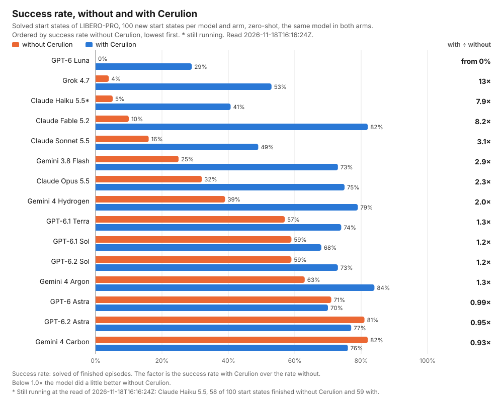
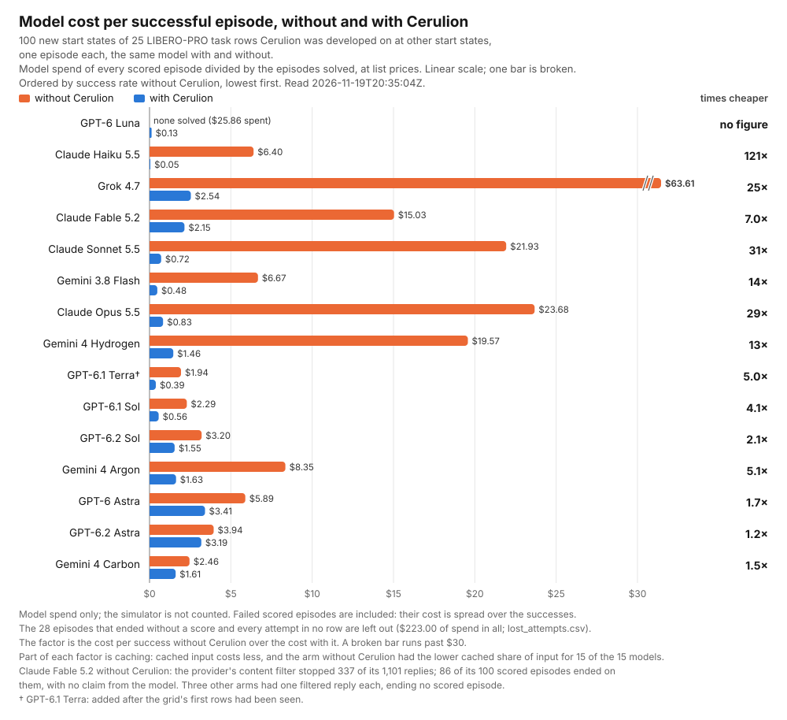
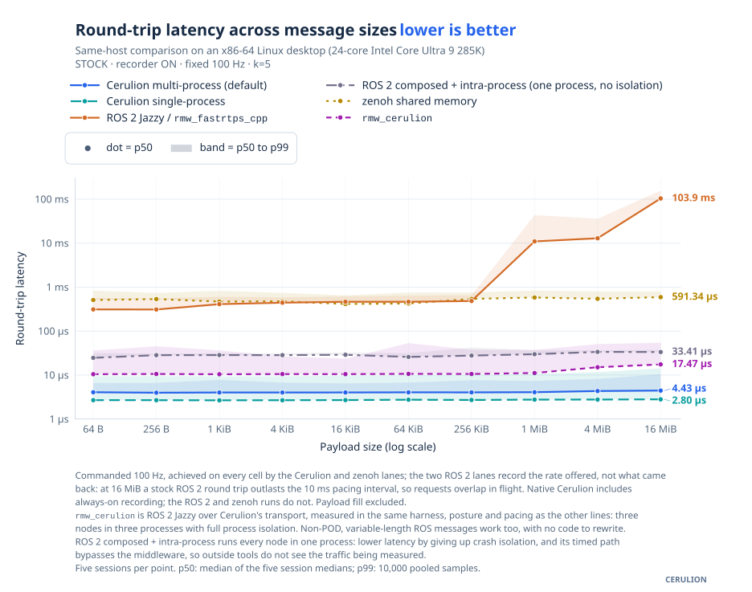

# Evidence

Nothing to install. Every figure is copied from a results package in this repository. The [README](../README.md#evidence) has the short version: the harness results, the latency table and the limits that change what each one means.

## Harness results

Each of 16 models ran the same 100 LIBERO-PRO start states twice. A start state is one task, such as "put the bowl on the stove", from one starting scene. The run without Cerulion used the benchmark's published minimal interface of three tools (arXiv:2610.30051). The run with Cerulion used the harness's tools and also read the robot's calibration record. Both had the same simulator, budget (80 model replies, 900 control steps) and success check.

- **The main test, declared before the first episode.** Gemini 3.8 Flash solved 73 of 100 start states with Cerulion and 25 without (2.9 times as many; exact two-sided sign test p = 1.10e-11).
- **All 16 models.** With Cerulion, 12 solved more and 4 solved fewer. The 4 that solved fewer are the 4 with the highest scores without Cerulion. After Holm's correction, the gain is established for 9 of 16.
- **Cost.** Gemini 3.8 Flash's model cost per solved start state, at list prices, was 6.67 USD without Cerulion and 0.48 USD with it. Part of that gap is caching.

<picture>
  <source media="(prefers-color-scheme: dark)" srcset="media/harness-success-rate-dark.svg">
  <source media="(prefers-color-scheme: light)" srcset="media/harness-success-rate-light.svg">
  
</picture>

<details>
<summary>Model cost per solved start state, for every model</summary>

<picture>
  <source media="(prefers-color-scheme: dark)" srcset="media/harness-cost-per-success-dark.svg">
  <source media="(prefers-color-scheme: light)" srcset="media/harness-cost-per-success-light.svg">
  
</picture>

</details>

## Latency

Round trips, **p50 / p99**, on one x86-64 Linux desktop (24-core Intel Core Ultra 9 285K, performance governor, no real-time tuning), 2026-09-16, at a nominal 100 Hz offered load. This is transport only: no payload byte is written inside the timed window, so a node's own work adds to it. The Cerulion columns include always-on Flashback, the default recorder.

| Payload | Cerulion multi-process (default) | Cerulion single process | ROS 2 Jazzy, `rmw_fastrtps_cpp` defaults | ROS 2 Jazzy, composed with intra-process |
|---|---:|---:|---:|---:|
| 64 B | 4.07 µs / 6.61 µs | 2.69 µs / 9.41 µs | 311.11 µs / 568.17 µs | 24.64 µs / 31.47 µs |
| 1 MiB | 4.08 µs / 7.38 µs | 2.76 µs / 10.74 µs | 11.0 ms / 43.4 ms | 29.79 µs / 36.99 µs |
| 16 MiB | 4.43 µs / 10.45 µs | 2.80 µs / 14.23 µs | 103.9 ms / 156.9 ms | 33.41 µs / 37.34 µs |

- At 1 MiB the ROS 2 defaults median is 2,687× the Cerulion default median.
- From 1 MiB up, the ROS 2 defaults median is longer than the 10 ms pacing interval (11.0 ms at 1 MiB), so those requests overlap.
- The composed lane runs every node in one process. Compare it with the single-process column.
- ROS 2 Jazzy on `rmw_cerulion`, three nodes in three processes with loaned publishing and loaned takes, reads **11.12 µs p50 / 37.21 µs p99** at 1 MiB. A publisher that still copies does not get these figures.

<picture>
  <source media="(prefers-color-scheme: dark)" srcset="media/native-rtt-dark.svg">
  <source media="(prefers-color-scheme: light)" srcset="media/native-rtt-light.svg">
  
</picture>

### Across platforms: Linux x86_64, NVIDIA Jetson and Apple Silicon

<picture>
  <source media="(prefers-color-scheme: dark)" srcset="media/platform-rtt-dark.svg">
  <source media="(prefers-color-scheme: light)" srcset="media/platform-rtt-light.svg">
  
</picture>

The Apple M4 row is a later build, Cerulion 2.0.0 on macOS 27.2.1 ([macOS two-process data wake](PERFORMANCE.md#macos-two-process-data-wake)).

## What the evidence does not show

- **One benchmark family.** The result is on the benchmark family the harness was built and checked on. The 100 start states are new, but their 25 task rows are ones the harness was developed on. Task rows it never met are on no list here.
- **More than tools.** The run with Cerulion also reads the simulated robot's calibration record. The comparison is the whole package against the published minimal interface.
- **Not every model gains.** With Cerulion, 4 of 16 models solved fewer, with no difference shown for each: GPT-6 Astra (70 against 71), Gemini 4 Carbon (76 against 82), GPT-6.2 Astra (77 against 81) and Gemini 4 Neon (90 against 93).
- **A filtered baseline.** Without Cerulion, 86 of Claude Fable 5.2's 100 episodes ended on replies the provider's content filter stopped, so most of its gain is against that filter.
- **More false claims per failure.** Pooled over the 16 models, an unsolved episode ended with a false success claim more often with Cerulion: 186 in 501 (0.371) against 255 in 905 (0.282).
- **One draw each, no ranking.** Each start state ran once each way, at temperature 1.0. Other groups publish higher rates under their own protocols, and nothing here ranks against them.
- **Simulation only.** Nothing here measures a model on a physical robot.
- **One machine per platform, transport only.** The latency table's figures are from one desktop, not a guarantee. The platform chart adds one NVIDIA Jetson Orin NX and one Apple M4, each its own package. The largest ratio is against ROS 2 defaults, not a tuned ROS 2 setup.

## Rerun a start state against your own model

Set `OPENAI_BASE_URL` to an OpenAI-compatible endpoint whose model takes tool calls and images, and `OPENAI_API_KEY` to its key. Pick a start state from [cells.csv](benchmarks/results/7cb9f322c10f6fa7-2026-11-18-harness-libero-pro/cells.csv):

```bash
cerulion rcp bench --model YOUR_MODEL --cell CELL_ID
```

It runs one episode with the harness and one without, each up to 3 attempts when the endpoint fails, and prints the benchmark's verdict for each. You pay for the model calls, and one episode can go either way. `cerulion rcp bench --verify` checks the harness code against its provenance ledger ([harness guide](harness.md)).

## Results packages and methodology

- The [harness results package](benchmarks/results/7cb9f322c10f6fa7-2026-11-18-harness-libero-pro/) holds a row for every episode, the reading rules (each frozen before the rows of its own lists) and a script that computes every figure again. Its [SUMMARY.md](benchmarks/results/7cb9f322c10f6fa7-2026-11-18-harness-libero-pro/SUMMARY.md) has the per-model false claims, the models added late and the content-filter readings. [Six transcripts](benchmarks/results/7cb9f322c10f6fa7-2026-11-18-harness-libero-pro/transcripts/README.md) show both runs for three models.
- Latency: the [native](benchmarks/results/8a84baf25d5d1710-2026-09-16-fixed100-heroes/HEADLINE.md) and [`rmw_cerulion`](benchmarks/results/8a84baf25d5d1710-2026-09-18-fixed100-rmw-cerulion/) packages, the [Jetson Orin NX](benchmarks/results/9b0c5fbf0f55dea4-2026-09-17-fixed100-jetson-orin-nx/) and [Apple M4](benchmarks/results/446db2afb7d26dbc-2026-11-13-fixed100-apple-m4/) packages behind the platform chart, [every package](benchmarks/README.md), [Performance](PERFORMANCE.md), [free run against lockstep](PERFORMANCE.md#free-run-against-lockstep), the [methodology](../benches/latency/METHODOLOGY.md) and the [benchmark suite](../benches/latency/README.md).
